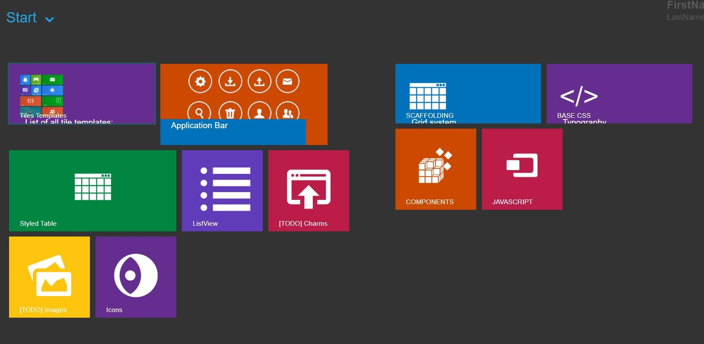

미니멀리즘에 기반한 2D 디자인 스타일로, 장식적 요소를 최소화하고 단순성과 기능성을 강조하는 접근 방식.
그림자, 질감, 광택을 걷어내고 색·형태·타이포그래피만으로 화면을 구성한다.



## 특징

- 단순한 요소와 평면적 디자인
- 선명한 가장자리와 열린 공간
- 밝고 대비가 강한 색상 사용
- 타이포그래피 강조
- 아이콘과 일러스트레이션의 기하학적 단순화

## 역사적 배경

### 등장 시기
2010년대 초반부터 본격화

### 주요 목적
- 사용자 경험 단순화
- 다양한 디바이스에서의 일관된 표현
- 페이지 로딩 시간 단축
- 고해상도 디스플레이에서도 선명한 벡터 기반 표현

<div class="mermaid">
timeline
  title 플랫 디자인의 진화
  2010 : Microsoft의 메트로 디자인 언어 소개
       : 윈도우 폰 7 출시
  2012 : 웹사이트에서 플랫 디자인 트렌드 확산
  2013 : Apple iOS 7 출시
       : 스큐어모피즘에서 플랫 디자인으로 전환
  2014 : Google Material Design 발표
       : 그림자를 되살린 '플랫 2.0'
  2020 : 뉴모피즘 등장
       : 플랫 디자인의 변형 시도
  2025 : iOS 26 Liquid Glass
       : 플랫 위에 반투명 재질을 얹는 방향
</div>

## 주요 디자인 요소

- 단색 또는 간단한 그라데이션
- 아이콘과 일러스트레이션의 단순화
- 여백(white space)의 적극적 활용
- 직관적인 내비게이션 구조
- 색과 크기로만 표현하는 위계

## 장단점

### 장점
- 빠른 로딩 속도와 가벼운 에셋
- 반응형·적응형 레이아웃에 적합
- 명확하고 직관적인 사용자 경험
- 콘텐츠에 집중할 수 있는 환경
- 해상도에 독립적 (벡터로 그리기 쉬움)

### 단점
- 차별화의 어려움
- 때로는 너무 단순해 보일 수 있음
- 클릭·탭 가능한 요소 구분의 어려움 (어포던스 상실)
- 깊이가 없어 계층 관계를 전달하기 어려움

## 대표적 적용 사례

- Microsoft Windows 8 이후 버전
- Apple iOS 7 이후 버전
- Google의 Material Design (플랫에 그림자를 더한 변형)
- 대다수의 현대 웹사이트와 모바일 앱 UI

## 현대 디자인에서의 위치

- 여전히 널리 사용되는 주류 디자인 스타일
- 다양한 변형과 결합 형태 등장 (뉴모피즘, 세미 플랫, 글라스모피즘)
- "플랫 2.0": 미묘한 그림자와 레이어를 되살려 어포던스 문제를 보완
- 사용성과 심미성의 균형을 위한 지속적인 진화

## iOS에서는

### HIG가 말하는 것

iOS 7은 플랫 디자인을 대중화한 사건이었다. 하지만 HIG는 "플랫하게 만들라"고 말한 적이 없다.
HIG가 말한 것은 **명료성, 존중, 깊이**다. 플랫은 그 결과였을 뿐이다.

특히 **깊이(Depth)**가 중요하다. iOS의 플랫 디자인은 완전한 2D가 아니다.

- 시트가 아래에서 올라오고, 뒤의 화면이 살짝 작아진다
- 내비게이션 바와 탭 바는 반투명 재질로 콘텐츠 위에 떠 있다
- 알림은 블러 처리된 배경 위에 뜬다

플랫은 **요소**의 표현이고, 깊이는 **레이어 간 관계**의 표현이다. 이 둘을 분리한 것이 iOS식 플랫 디자인이다.
iOS 26의 Liquid Glass는 이 균형을 재질 쪽으로 한 걸음 옮긴 것이지, 플랫을 버린 것이 아니다. 콘텐츠 자체는 여전히 플랫하다.

### SwiftUI로 구현하기

SwiftUI의 기본 모습이 곧 iOS식 플랫 디자인이다. 특별히 할 일은 "덧붙이지 않는 것"이다.

```swift
struct TaskRow: View {
    let task: Task

    var body: some View {
        HStack(spacing: 12) {
            Image(systemName: task.isDone ? "checkmark.circle.fill" : "circle")
                .foregroundStyle(task.isDone ? .green : .secondary)  // 색으로만 상태 표현
                .imageScale(.large)
            Text(task.title)
                .strikethrough(task.isDone)
                .foregroundStyle(task.isDone ? .secondary : .primary)
            Spacer()
            if task.isFlagged {
                Image(systemName: "flag.fill")
                    .foregroundStyle(.orange)
            }
        }
        .padding(.vertical, 4)
    }
}
```

어포던스를 보완할 때는 그림자 대신 **색과 모양**을 쓴다.

```swift
Button("시작하기") { }
    .buttonStyle(.borderedProminent)   // 채워진 배경으로 '눌 수 있음'을 표현
    .controlSize(.large)

Button("나중에") { }
    .buttonStyle(.bordered)            // 연한 배경으로 보조 동작 표현
```

### 주의할 점

- **탭 가능한 것과 아닌 것의 구분**: 플랫의 가장 큰 약점. 버튼은 `tint` 색을 쓰고 일반 텍스트는 `.primary`를 써서 색으로 구분한다
- **배경과 전경**: 단색 배경 위에 단색 카드를 놓으면 경계가 사라진다. `.background`와 `.secondarySystemBackground` 같은 의미론적 색상 쌍을 쓴다
- **아이콘**: SF Symbols의 기본 렌더링은 플랫하다. 커스텀 아이콘도 같은 선 굵기와 모서리 반경을 맞춘다
- **색 의존 금지**: 색만으로 상태를 전달하면 색각 이상 사용자가 놓친다. 아이콘 모양이나 텍스트를 함께 바꾼다 (위 예시의 `checkmark.circle.fill` ↔ `circle`)

## 웹과 iOS 대응표

| 웹 | iOS / SwiftUI |
|---|---|
| `box-shadow: none`, 단색 배경 | SwiftUI 기본 모습 |
| 채워진 버튼 / 외곽선 버튼 | `.borderedProminent` / `.bordered` |
| SVG 아이콘 | SF Symbols |
| `z-index`로 쌓기 | `ZStack`, 시트, Material로 레이어 깊이 표현 |
| CSS 단색 테마 변수 | 의미론적 색상 (`.primary`, `.background`) |

## 함께 읽기

- [스큐어모피즘: 디지털 세계의 현실 모방]() — 플랫이 밀어낸 것
- [미니멀리즘 디자인: 적은 것이 더 많은 것이다]() — 플랫의 철학적 배경
- [머티리얼 디자인: 디지털 세계의 물리적 메타포]() — 플랫에 그림자를 되살린 변형
