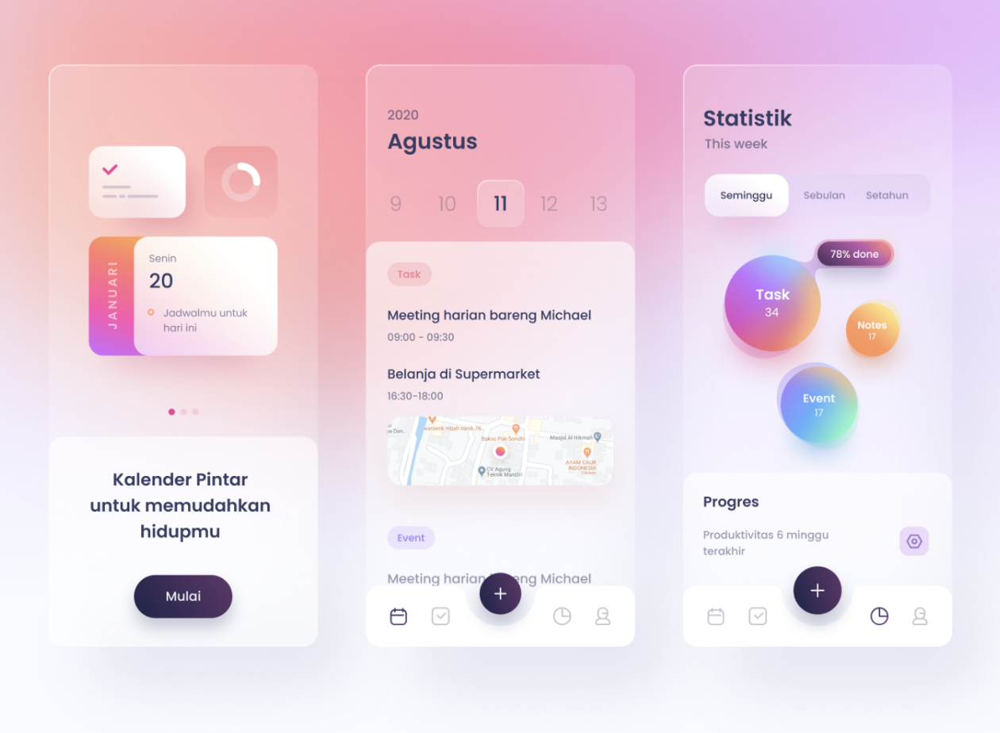

글라스모피즘(Glassmorphism)은 유리나 반투명 소재의 특성을 디지털 인터페이스에 적용한 UI 디자인 스타일.
배경을 흐리게 비추는 반투명 패널 위에 콘텐츠를 올려 깊이와 계층을 표현한다.



# 특징

- 반투명 효과와 배경 블러 처리
- 다층 구조의 시각적 계층감
- 부드러운 그림자 효과
- 생생한 색상과 그라데이션 배경 (유리가 비출 것이 있어야 한다)
- 얇은 밝은 테두리로 유리 가장자리 표현
- 배경과의 조화로운 상호작용 (스크롤하면 뒤의 색이 비쳐 지나간다)

# 역사적 배경

## 등장 시기
2020년 macOS Big Sur와 iOS 14 출시 이후 "글라스모피즘"이라는 이름으로 본격화. 뿌리는 2013년 iOS 7의 블러 효과

## 주요 목적
- 깊이감과 공간감 제공
- 시각적 계층 구조 강화
- 콘텐츠를 가리지 않으면서 UI를 얹는 방법

<div class="mermaid">
timeline
 title 글라스모피즘의 발전
 2007 : Windows Vista의 Aero Glass
 2013 : iOS 7, 블러 처리된 반투명 바와 컨트롤 센터
 2020 : macOS Big Sur, iOS 14 위젯
      : '글라스모피즘'이라는 이름이 붙음
 2021 : 웹 디자인에서 트렌드 확산
      : backdrop-filter 브라우저 지원 확대
 2022 : Windows 11 Mica / Acrylic 재질
 2025 : iOS 26 Liquid Glass
      : 블러를 넘어 빛의 굴절과 반사를 실시간 렌더링
</div>

# 주요 디자인 요소

- 반투명 배경 (웹에서는 `backdrop-filter: blur()`)
- 부드러운 그림자 효과
- 미묘한 테두리 처리 (1px 밝은 선)
- 프로스트 글라스(frosted glass) 효과
- 다층 구조의 요소 배치
- 생생한 색상과 그라데이션 배경

# 장단점

## 장점
- 시각적으로 매력적이고 현대적인 느낌
- 깊이감과 공간감 제공
- 배경과의 자연스러운 조화
- 콘텐츠 계층 구조의 명확한 표현
- UI가 콘텐츠를 완전히 가리지 않음

## 단점
- 과도한 사용 시 가독성 저하 (뒤의 콘텐츠에 따라 대비가 변한다)
- 성능 문제 (실시간 블러는 GPU 비용이 크다)
- 접근성 고려 필요 (시각적 대비, 투명도 줄이기 설정)
- 오래된 브라우저에서의 호환성 문제
- 배경이 단색이면 효과가 사라진다

# 대표적 적용 사례

- Apple의 macOS Big Sur 이후 인터페이스
- iOS의 컨트롤 센터, 알림, 위젯, 탭 바
- Microsoft의 Fluent Design System (Acrylic)
- Stripe 등 웹사이트의 히어로 섹션
- 다양한 대시보드 UI 디자인

# 현대 UI/UX 디자인에서의 위치

- 모던하고 미래지향적인 디자인 트렌드로 부상
- 스마트폰과 태블릿 UI에서 널리 활용
- 2025년 Apple이 Liquid Glass로 전 플랫폼의 기본 재질로 채택하면서 **주류 중의 주류**가 됨
- 뉴모피즘과 달리 접근성 대안(투명도 줄이기)이 OS 차원에서 마련되어 있다

# iOS에서는

## HIG가 말하는 것

글라스모피즘은 Apple이 **만들고, 이름 붙여지고, 다시 가져간** 스타일이다.

iOS 7 때부터 HIG는 "Deference"의 수단으로 반투명을 제시했다. 내비게이션 바가 반투명한 이유는 아래 콘텐츠가 비쳐서 "더 있다"는 신호를 주기 위함이다.
HIG는 이것을 **Material(재질)**이라고 부르며, 다섯 단계의 두께를 제공한다.

- Ultra Thin / Thin / Regular / Thick / Ultra Thick
- 각 재질은 라이트/다크 모드와 "투명도 줄이기" 설정에 자동으로 대응한다

2025년 iOS 26의 **Liquid Glass**는 한 단계 더 나아간다.

- 단순 블러가 아니라 빛의 굴절(refraction)과 주변 색의 반사를 실시간으로 렌더링
- 컨트롤이 콘텍스트에 따라 모양을 바꾸고(morph), 여러 요소가 하나의 유리로 합쳐진다
- 탭 바, 툴바, 알림, 위젯 등 시스템 컨트롤 전반에 적용
- HIG는 Liquid Glass를 **내비게이션 레이어에만** 쓰고, 콘텐츠 레이어에는 쓰지 말라고 안내한다. 유리 위에 유리를 겹치면 읽을 수 없다

## SwiftUI로 구현하기

**시스템 Material (iOS 15+)**

```swift
VStack(alignment: .leading) {
    Text("지금 재생 중")
        .font(.caption)
        .foregroundStyle(.secondary)
    Text("Blue in Green")
        .font(.headline)
}
.padding()
.background(.regularMaterial, in: RoundedRectangle(cornerRadius: 16))
```

Material을 쓰면 블러, 틴트, 다크 모드, 투명도 줄이기가 모두 자동이다. 직접 `.opacity`와 `.blur`를 조합하는 것보다 항상 낫다.

**Liquid Glass (iOS 26+)**

```swift
HStack(spacing: 12) {
    Button("이전", systemImage: "backward.fill") { }
    Button("재생", systemImage: "play.fill") { }
    Button("다음", systemImage: "forward.fill") { }
}
.padding()
.glassEffect(.regular, in: Capsule())
```

여러 유리 요소를 묶을 때는 `GlassEffectContainer`로 감싸서 서로 가까워지면 하나로 합쳐지게 한다.

**커스텀 유리 (하위 버전 호환)**

```swift
RoundedRectangle(cornerRadius: 20)
    .fill(.white.opacity(0.15))
    .background(.ultraThinMaterial, in: RoundedRectangle(cornerRadius: 20))
    .overlay(
        RoundedRectangle(cornerRadius: 20)
            .strokeBorder(.white.opacity(0.4), lineWidth: 1)   // 유리 가장자리
    )
```

## 주의할 점

- **투명도 줄이기**: 시스템 Material을 쓰면 자동으로 처리된다. 직접 만든 유리는 `accessibilityReduceTransparency` 환경값을 읽어 불투명한 배경으로 바꾼다
- **텍스트 대비**: 유리 뒤에 무엇이 올지 모른다. 유리 위의 텍스트는 `.primary`를 쓰고, 중요한 텍스트 뒤에는 한 겹 더 어두운 `.thickMaterial`을 둔다
- **유리 위에 유리 금지**: 시트 안에 Material 카드를 넣고 그 안에 또 Material 버튼을 두면 흐릿한 덩어리가 된다. 한 화면에 유리 레이어는 하나
- **성능**: Material은 아래 레이어를 실시간으로 샘플링한다. `LazyVStack` 셀마다 쓰면 스크롤이 무거워진다. 바, 플로팅 패널, 오버레이에만 쓴다
- **배경이 있어야 한다**: 단색 배경 위의 유리는 그냥 회색 사각형이다. 사진, 그라데이션, 아니면 아래로 지나가는 콘텐츠가 있어야 효과가 산다

# 웹과 iOS 대응표

| 웹 | iOS / SwiftUI |
|---|---|
| `backdrop-filter: blur(20px)` | `Material` (`.ultraThin` ~ `.ultraThick`) |
| `background: rgba(255,255,255,.15)` | Material에 내장된 틴트 |
| `border: 1px solid rgba(255,255,255,.4)` | `.overlay` + `.strokeBorder` |
| `@media (prefers-reduced-transparency)` | `accessibilityReduceTransparency` |
| (대응 없음) | `glassEffect`, `GlassEffectContainer` (iOS 26) |

# 함께 읽기

- [뉴모피즘: 디지털 세계의 새로운 질감]() — 같은 시기의 경쟁 스타일
- [플랫 디자인: 단순함의 미학]() — 유리 아래에 깔리는 콘텐츠의 스타일
- [비주얼 계층구조: 시각적 중요도의 체계화]() — 재질로 계층을 표현하는 법
