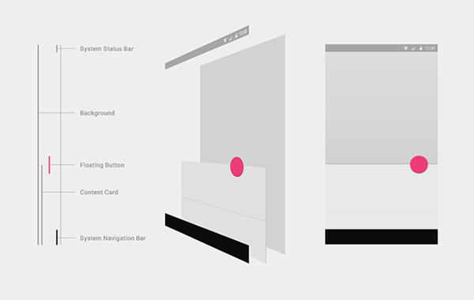

Google이 개발한 디자인 언어로, "종이와 잉크"라는 물리적 메타포를 디지털 인터페이스에 적용한 디자인 스타일.
플랫 디자인의 단순함을 유지하면서 그림자와 모션으로 깊이를 되살렸다.



## 특징

- 물리적 표면(종이)과 가장자리를 모방한 디자인
- 그림자와 고도(elevation)를 통한 계층 표현
- 의미 있는 애니메이션과 전환 효과 (잉크가 퍼지는 리플 효과)
- 반응형 디자인 원칙 적용
- 디자인 가이드와 코드 라이브러리를 함께 제공하는 **디자인 시스템**

## 역사적 배경

### 등장 시기
2014년 Google I/O 컨퍼런스에서 공식 발표

### 주요 목적
- 다양한 플랫폼과 기기에서 일관된 사용자 경험 제공
- 물리적 세계의 직관성을 디지털 인터페이스에 적용
- Android 생태계의 파편화된 디자인을 통일

<div class="mermaid">
timeline
  title 머티리얼 디자인의 진화
  2014 : Google I/O에서 머티리얼 디자인 발표
  2015 : Android Lollipop에서 본격적인 도입
  2018 : 머티리얼 디자인 2.0 (Material Theming)
       : 브랜드별 커스터마이징 지원
  2021 : 머티리얼 You (Material 3)
       : 배경화면 기반 동적 색상, 개인화
  2025 : Material 3 Expressive
       : 더 과감한 형태와 모션
</div>

## 주요 디자인 요소

- 종이와 잉크 개념을 디지털로 해석
- 입체감을 주는 그림자와 광원 효과 (고도 단계)
- 의미 있는 모션과 애니메이션
- 대담한 색상과 타이포그래피
- 그리드 기반의 레이아웃 시스템
- 플로팅 액션 버튼(FAB), 스낵바, 내비게이션 드로어 같은 고유 컴포넌트

## 장단점

### 장점
- 직관적이고 일관된 사용자 경험
- 다양한 기기와 화면 크기에 대한 적응성
- 시각적 풍부함과 동적인 상호작용
- 가이드라인과 구현체(Jetpack Compose, MUI 등)가 함께 제공됨

### 단점
- 구글의 가이드라인을 따르다 보면 독창성 제한 가능
- 과도한 애니메이션으로 인한 성능 이슈
- 모든 애플리케이션에 적합하지는 않음
- **iOS에 그대로 가져오면 "안드로이드 앱 같다"는 인상을 준다**

## 대표적 적용 사례

- Google의 Android 운영 체제
- Gmail, Google Drive 등 구글 서비스
- 많은 Android 앱과 웹 애플리케이션 (MUI, Angular Material)

## 현대 디자인에서의 위치

- Android 생태계의 주요 디자인 언어로 자리잡음
- 웹 디자인에도 영향을 미쳐 많은 웹사이트에서 채택
- 지속적인 업데이트를 통해 현대적 디자인 트렌드 반영
- HIG와 함께 **두 개의 플랫폼 디자인 시스템**을 이루며, 크로스 플랫폼 앱의 영원한 고민거리

## iOS에서는

### HIG가 말하는 것

머티리얼 디자인은 iOS에서 **쓰지 않는** 스타일이다. 대신 "번역"하는 대상이다.
HIG는 다른 플랫폼의 패턴을 그대로 옮기지 말고, iOS 사용자가 기대하는 패턴으로 바꾸라고 말한다.

두 시스템은 같은 문제를 다르게 푼다.

| 문제 | 머티리얼 (Android) | HIG (iOS) |
|---|---|---|
| 주요 동작 | 플로팅 액션 버튼(FAB) | 내비게이션 바 또는 툴바의 버튼 |
| 최상위 이동 | 하단 내비게이션 바 (3~5개) | 탭 바 (2~5개) |
| 뒤로 가기 | 시스템 뒤로 버튼 / 제스처 | 내비게이션 바 왼쪽 "< 이전", 가장자리 스와이프 |
| 짧은 알림 | 스낵바 / 토스트 | 없음. 상태를 인라인으로 보여 주거나 알림(Alert) |
| 메뉴 | 내비게이션 드로어 (햄버거) | 탭 바 또는 사이드바 (iPad) |
| 계층 표현 | 고도(elevation)와 그림자 | 반투명 재질과 레이어 |
| 터치 피드백 | 리플 효과 | 하이라이트 + 햅틱 |
| 설정 화면 | 리스트 + 토글 | 인셋 그룹 리스트 + 토글 |

핵심은 **구조는 플랫폼을 따르고, 브랜드는 색과 톤으로 표현한다**는 것이다.

### SwiftUI로 구현하기

머티리얼의 의도를 iOS 컴포넌트로 옮기는 예시.

```swift
// 머티리얼: FAB + 하단 내비게이션 + 스낵바
// iOS 번역:
struct NotesView: View {
    @State private var showSaved = false

    var body: some View {
        TabView {                                 // 하단 내비게이션 → 탭 바
            NavigationStack {
                List(notes) { NoteRow(note: $0) }
                    .navigationTitle("메모")
                    .toolbar {                    // FAB → 툴바 버튼
                        ToolbarItem(placement: .primaryAction) {
                            Button("새 메모", systemImage: "square.and.pencil") {
                                addNote()
                                showSaved = true
                            }
                        }
                    }
            }
            .tabItem { Label("메모", systemImage: "note.text") }

            SettingsView()
                .tabItem { Label("설정", systemImage: "gear") }
        }
        .sensoryFeedback(.success, trigger: showSaved)   // 스낵바 → 햅틱 + 인라인 상태
    }
}
```

머티리얼의 "그림자 고도"를 꼭 표현하고 싶다면 Material로 바꾼다.

```swift
// Android: elevation 4dp
// iOS:
CardContent()
    .background(.thinMaterial, in: RoundedRectangle(cornerRadius: 12))
```

### 주의할 점

- **크로스 플랫폼 프레임워크**(Flutter, React Native)로 만든 앱이 머티리얼 위젯을 그대로 쓰면 iOS에서 이질감이 크다. iOS 빌드에는 Cupertino 계열 위젯을 쓰거나 네이티브 컴포넌트를 섞는다
- **FAB를 iOS에 넣지 않는다**. 콘텐츠를 가리고, 엄지 영역과 탭 바가 충돌한다
- **동적 색상(Material You)**은 iOS에 대응하는 개념이 없다. 대신 `tint`로 앱 강조색을 하나 정하고, 시스템 색상 체계를 따른다
- **아이콘**: Material Symbols와 SF Symbols는 선 굵기와 모서리 처리가 다르다. iOS 빌드에서는 SF Symbols로 바꾼다

## 웹과 iOS 대응표

| 머티리얼 / 웹 | iOS / SwiftUI |
|---|---|
| `FloatingActionButton` | `ToolbarItem(placement: .primaryAction)` |
| `BottomNavigation` | `TabView` |
| `Snackbar` | 인라인 상태 표시 + `sensoryFeedback` |
| `Drawer` | `TabView` 또는 `NavigationSplitView` 사이드바 |
| `elevation` | `Material`, `.shadow` (절제) |
| `Ripple` | `ButtonStyle` 눌림 상태 + 햅틱 |
| Material Symbols | SF Symbols |

## 함께 읽기

- [플랫 디자인: 단순함의 미학]() — 머티리얼이 출발한 곳
- [애니메이션과 모션: 동적 사용자 경험의 핵심]() — 머티리얼이 특히 강조한 영역
- [디자인 시스템: 일관된 사용자 경험의 기반]()
