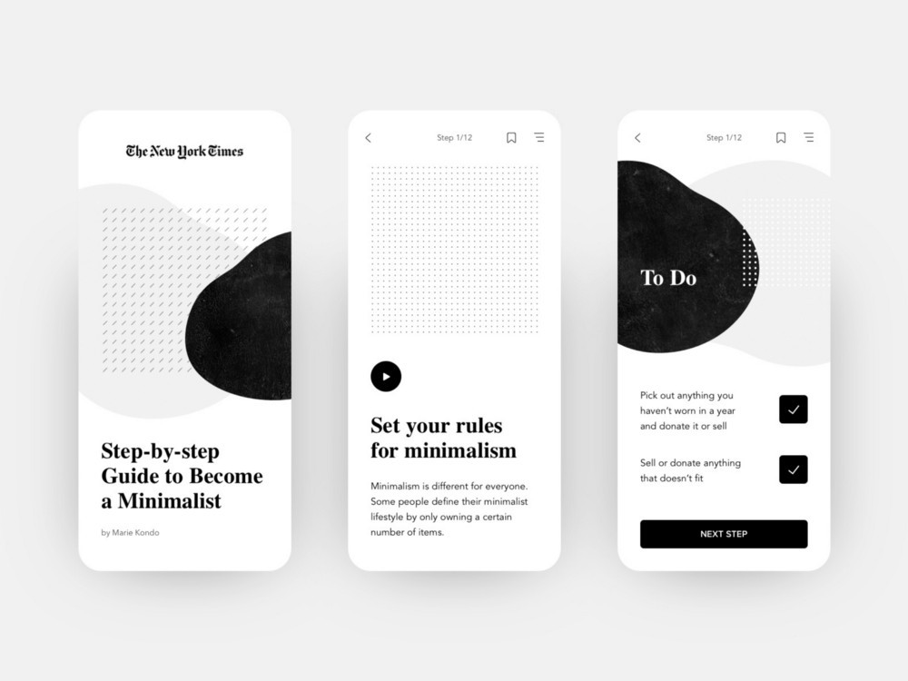

"적은 것이 더 많은 것이다(Less is More)"라는 원칙을 따르는 디자인 철학.
불필요한 요소를 제거하고 본질에 집중하는 접근 방식으로, 플랫 디자인과 타이포그래피 중심 디자인의 바탕이 된다.



## 특징

- 단순하고 깔끔한 레이아웃
- 제한된 색상 팔레트 사용
- 여백(화이트 스페이스)의 적극적 활용
- 핵심 기능과 콘텐츠에 집중
- 장식적 요소의 최소화
- 한 화면에 한 가지 목적

## 역사적 배경

### 등장 시기
1960년대 예술 분야에서 시작, 디지털 디자인에는 2010년대 초반부터 본격적으로 적용

### 주요 목적
- 사용자의 주의를 분산시키는 요소 제거
- 핵심 메시지나 기능에 집중할 수 있는 환경 제공
- 빠른 로딩 시간과 반응성 향상

<div class="mermaid">
timeline
  title 미니멀리즘 디자인의 진화
  1960 : 예술 분야에서 미니멀리즘 운동 시작
  1980 : 그래픽 디자인에 미니멀리즘 영향 확대
  2001 : iPod 출시, 하드웨어 미니멀리즘의 상징
  2007 : iPhone 출시, 버튼 하나의 모바일 UI
  2013 : iOS 7, 플랫 디자인과 결합한 미니멀리즘 강화
  2020 : 디지털 미니멀리즘, UX 설계의 핵심 원칙으로 자리잡음
</div>

## 주요 디자인 요소

- 단순한 형태와 기하학적 도형
- 제한된 색상 사용 (주로 흑백 또는 단색 + 강조색 하나)
- 타이포그래피의 중요성 강조
- 그리드 시스템을 활용한 정렬
- 아이콘과 일러스트레이션의 단순화
- 숨기기보다 **빼기**: 메뉴 뒤에 감추는 것이 아니라 기능 자체를 줄인다

## 장단점

### 장점
- 사용자 경험의 명확성과 직관성 향상
- 빠른 로딩 시간과 성능 개선
- 반응형·적응형 레이아웃에 적합
- 시간이 지나도 변하지 않는 세련된 느낌
- 유지보수 비용 감소

### 단점
- 브랜드 개성 표현의 제한
- 때로는 너무 단순해 보일 수 있음
- 정보 전달의 제한 가능성
- 사용자 참여 유도의 어려움
- "미니멀"을 핑계로 필요한 기능이나 설명을 빼 버릴 위험

## 대표적 적용 사례

- Apple의 제품 디자인 및 웹사이트
- Google의 검색 페이지
- Airbnb의 웹사이트 및 모바일 앱
- Things, Bear 같은 생산성 앱
- 많은 현대적인 포트폴리오 웹사이트

## 현대 디자인에서의 위치

- UX/UI 디자인의 기본 원칙으로 자리잡음
- 다양한 디지털 플랫폼에서 광범위하게 활용
- 다른 디자인 트렌드와 결합하여 진화 중 (뉴모피즘, 글라스모피즘과의 결합)

## iOS에서는

### HIG가 말하는 것

HIG는 "미니멀리즘"이라는 단어를 쓰지 않지만, 거의 모든 페이지가 미니멀리즘을 전제로 한다.

- **콘텐츠가 주인공**: UI는 콘텐츠를 담는 그릇이고, 그릇이 음식보다 눈에 띄면 안 된다
- **한 화면, 한 과제**: iPhone 화면은 작다. 한 화면에서 할 일을 하나로 좁히고 나머지는 다음 화면으로 넘긴다
- **표준 컨트롤 사용**: 새 컨트롤을 발명하지 않는다. 사용자가 이미 아는 것을 쓰면 설명이 필요 없다
- **점진적 공개(Progressive Disclosure)**: 고급 옵션은 처음부터 보이지 않고, 필요할 때 드러난다

Apple의 기본 앱이 이 태도의 교과서다. 메모 앱은 빈 화면과 글쓰기 버튼 하나로 시작하고, 서식 도구는 키보드 위에 접혀 있다.

### SwiftUI로 구현하기

SwiftUI는 미니멀리즘을 코드 구조로 강제하는 면이 있다. 뷰가 커지면 코드가 먼저 불편해진다.

```swift
struct TimerView: View {
    @State private var remaining: TimeInterval = 25 * 60
    @State private var isRunning = false

    var body: some View {
        VStack(spacing: 48) {
            Spacer()

            Text(remaining.formatted(.time(pattern: .minuteSecond)))
                .font(.system(size: 88, weight: .light, design: .rounded))
                .monospacedDigit()                         // 숫자가 바뀌어도 폭 고정
                .contentTransition(.numericText())         // 숫자만 조용히 바뀜

            Button(isRunning ? "일시정지" : "시작") {
                isRunning.toggle()
            }
            .buttonStyle(.borderedProminent)
            .controlSize(.large)

            Spacer()
        }
        .padding()
        .toolbar {                                          // 부가 기능은 툴바로 밀어냄
            ToolbarItem(placement: .topBarTrailing) {
                Menu("더 보기", systemImage: "ellipsis.circle") {
                    Button("초기화", systemImage: "arrow.counterclockwise") { }
                    Button("설정", systemImage: "gear") { }
                }
            }
        }
    }
}
```

화면에는 숫자와 버튼 하나만 남고, 나머지는 `Menu` 뒤로 들어간다. 이것이 점진적 공개다.

### 주의할 점

- **미니멀 ≠ 설명 생략**: 아이콘만 있는 버튼에는 반드시 `accessibilityLabel`이나 `Label`의 텍스트가 있어야 한다. 시각적으로 숨겨도 VoiceOver에는 들려야 한다
- **발견 가능성**: 제스처 뒤에 숨긴 기능은 사용자가 모른다. 중요한 기능은 보이는 곳에 둔다
- **빈 화면(Empty State)**: 미니멀한 앱은 첫 화면이 비어 있기 쉽다. `ContentUnavailableView`로 "무엇을 할 수 있는지"를 보여 준다
- **여백은 Dynamic Type과 함께 늘어나야 한다**: 고정 `frame`을 쓰면 큰 글자 설정에서 레이아웃이 깨진다

## 웹과 iOS 대응표

| 웹 | iOS / SwiftUI |
|---|---|
| 햄버거 메뉴에 기능 숨기기 | `Menu`, 툴바, 컨텍스트 메뉴 |
| 빈 상태 일러스트 + 문구 | `ContentUnavailableView` |
| 단일 강조색 CSS 변수 | `.tint` |
| 대형 디스플레이 숫자 폰트 | `.font(.system(size:weight:design:))` + `.monospacedDigit()` |
| 접힌 "고급 설정" 섹션 | `DisclosureGroup`, 별도 설정 화면 |

## 함께 읽기

- [플랫 디자인: 단순함의 미학]() — 미니멀리즘의 시각적 표현
- [화이트 스페이스 활용: 여백의 미학]() — 미니멀리즘의 핵심 도구
- [타이포그래피 중심 디자인: 글자의 힘]()
