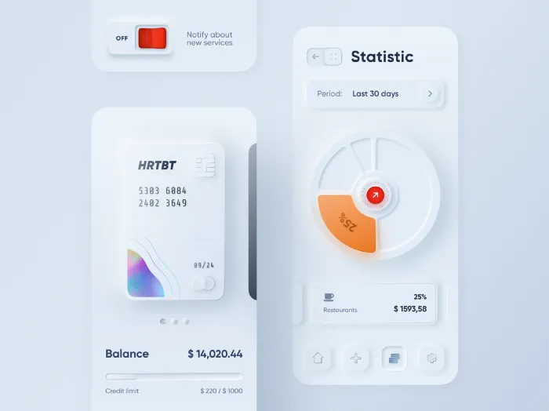

뉴모피즘(Neumorphism)은 새로움(New)과 스큐어모피즘(Skeuomorphism)의 합성어.
UI 요소가 배경과 같은 색으로 배경에서 "솟아오르거나 눌려 들어간" 것처럼 보이는 소프트 UI 스타일이다.



## 특징

- 부드러운 그림자 효과로 입체감 표현 (밝은 그림자 + 어두운 그림자 한 쌍)
- 배경색과 유사한 색상의 UI 요소 사용
- 미니멀리즘적 접근과 현실감 있는 텍스처의 결합
- 은은한 색상 대비와 부드러운 경계선
- 돌출(convex)과 함몰(concave) 두 상태로 눌림을 표현

## 역사적 배경

### 등장 시기
2019년 말 Dribbble 등 디자인 커뮤니티에서 주목받기 시작

### 주요 목적
- 플랫 디자인의 단조로움 극복
- 스큐어모피즘의 과도한 현실감 지양
- 디지털 인터페이스에 새로운 질감과 깊이감 부여

<div class="mermaid">
timeline
  title 뉴모피즘의 발전
  2019 : 디자인 커뮤니티에서 개념 등장
  2020 : 콘셉트 작업과 UI 키트 확산
  2021 : 접근성 비판 본격화, 하이브리드 형태 등장
  2022 : 스마트홈·대시보드 등 특정 영역에서 정착
  2025 : 글라스모피즘 계열(Liquid Glass)에 주류 자리를 내줌
</div>

## 주요 디자인 요소

- 소프트 UI: 부드러운 돌출 효과와 그림자
- 모노크롬에 가까운 색상 팔레트
- 미묘한 그라데이션과 텍스처
- 최소한의 대비를 통한 깊이감 표현
- 부드러운 모서리와 둥근 형태

## 장단점

### 장점
- 시각적으로 편안하고 부드러운 사용자 경험
- 독특하고 현대적인 미적 감각
- 터치 인터페이스에 적합한 "눌림" 피드백
- 요소 수가 적은 화면(리모컨, 플레이어)에서 특히 효과적

### 단점
- **접근성 문제**: 낮은 대비로 인한 가독성 저하. 저시력 사용자는 버튼을 인식하지 못할 수 있다
- 복잡한 UI에 적용 시 제한적 (요소가 많아지면 그림자가 뒤섞임)
- 과도한 사용 시 사용성 저하
- 비활성 상태, 선택 상태 등 다양한 상태를 표현할 여지가 적다
- 다크 모드에서 밝은 그림자를 표현하기 어렵다

## 대표적 적용 사례

- 스마트홈 기기의 컨트롤 패널 UI
- 음악 플레이어, 계산기 등 컨트롤 중심 앱
- 대시보드의 일부 위젯
- 웹사이트의 특정 UI 요소 (버튼, 카드)

## 현대 디자인에서의 위치

- 플랫 디자인과 스큐어모피즘의 중간 지점
- 특정 제품이나 브랜드 아이덴티티 표현에 활용
- 주류가 되지는 못했지만 "부드러운 입체감"이라는 감각은 글라스모피즘으로 이어졌다

## iOS에서는

### HIG가 말하는 것

HIG에 뉴모피즘은 등장하지 않는다. 그리고 HIG의 두 원칙이 뉴모피즘과 정면으로 충돌한다.

- **명료성**: HIG는 텍스트와 중요한 UI 요소에 충분한 대비를 요구한다. 뉴모피즘은 의도적으로 대비를 낮춘다
- **접근성 설정 지원**: iOS에는 "대비 높이기", "투명도 줄이기", "버튼 모양" 같은 설정이 있다. 뉴모피즘은 이 설정이 켜지면 정체성을 잃는다

따라서 iOS에서 뉴모피즘은 **앱 전체 스타일이 아닌, 특정 컨트롤의 장식**으로만 쓰는 것이 현실적이다.
그리고 그 장식은 접근성 설정이 켜지면 사라져야 한다.

### SwiftUI로 구현하기

뉴모피즘의 핵심인 "두 방향 그림자"는 `.shadow`를 두 번 겹치면 된다.

```swift
struct NeumorphicButtonStyle: ButtonStyle {
    @Environment(\.colorSchemeContrast) private var contrast
    @Environment(\.colorScheme) private var scheme

    func makeBody(configuration: Configuration) -> some View {
        let base = Color(.systemGray6)
        let pressed = configuration.isPressed

        configuration.label
            .padding(24)
            .background {
                if contrast == .increased {
                    // 대비 높이기가 켜지면 평범한 버튼으로 전환
                    RoundedRectangle(cornerRadius: 20)
                        .fill(base)
                        .strokeBorder(.primary, lineWidth: 2)
                } else {
                    RoundedRectangle(cornerRadius: 20)
                        .fill(base)
                        .shadow(color: .white.opacity(scheme == .dark ? 0.08 : 0.9),
                                radius: 8, x: pressed ? 2 : -6, y: pressed ? 2 : -6)
                        .shadow(color: .black.opacity(scheme == .dark ? 0.6 : 0.15),
                                radius: 8, x: pressed ? -2 : 6, y: pressed ? -2 : 6)
                }
            }
            .scaleEffect(pressed ? 0.98 : 1)
            .animation(.easeOut(duration: 0.15), value: pressed)
    }
}
```

눌렸을 때 그림자 방향을 뒤집으면 "들어간" 느낌이 난다. 애니메이션은 짧게(0.1~0.2초) 유지한다.

### 주의할 점

- **대비 기준**: 텍스트는 배경과 4.5:1, 아이콘과 컨트롤 외곽은 3:1 이상의 대비를 확보한다. 뉴모피즘 버튼 위의 텍스트는 거의 항상 이 기준에 걸린다
- **`colorSchemeContrast`**: 위 예시처럼 대비 높이기 설정을 읽어 대체 모습을 제공한다
- **다크 모드**: 밝은 그림자는 다크 모드에서 거의 보이지 않는다. 투명도를 따로 조정하거나, 다크 모드에서는 어두운 그림자 하나만 쓴다
- **상태 표현**: 비활성(`disabled`) 상태는 그림자를 모두 없애고 불투명도를 낮추는 식으로 명확히 구분한다
- **성능**: `.shadow`는 비용이 있다. 리스트 셀마다 두 겹씩 쓰면 스크롤이 버벅인다. 화면에 몇 개 안 되는 컨트롤에만 쓴다

## 웹과 iOS 대응표

| 웹 | iOS / SwiftUI |
|---|---|
| `box-shadow: -6px -6px 12px #fff, 6px 6px 12px #ccc` | `.shadow` 두 번 겹치기 |
| `box-shadow: inset ...` (눌림) | 눌림 상태에서 그림자 방향 반전 |
| `@media (prefers-contrast: more)` | `colorSchemeContrast` 환경값 |
| `@media (prefers-color-scheme: dark)` | `colorScheme` 환경값 |
| `:active` | `ButtonStyle`의 `configuration.isPressed` |

## 함께 읽기

- [스큐어모피즘: 디지털 세계의 현실 모방]() — 뉴모피즘의 어원
- [플랫 디자인: 단순함의 미학]() — 뉴모피즘이 벗어나려 한 것
- [글라스모피즘: 투명함의 미학]() — 비슷한 시기에 등장해 주류가 된 경쟁자
