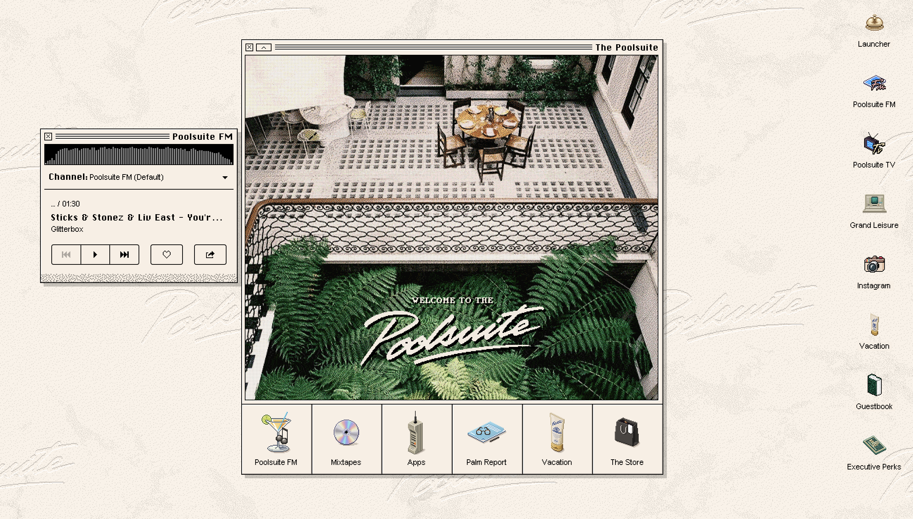

과거의 디지털 인터페이스 요소를 현대적으로 재해석하여 사용자에게 독특한 경험을 제공하는 디자인 접근 방식.
픽셀 아트, CRT 스캔라인, 초기 GUI의 입체 버튼 같은 요소로 향수를 자극한다.



# 특징

- 초기 컴퓨터 UI 요소의 현대적 재현
- 픽셀 아트와 8비트 그래픽 스타일
- CRT 모니터 효과나 스캔라인 텍스처
- 제한된 색상 팔레트 사용
- 복고풍 아이콘과 커서 디자인
- 구식 타이포그래피 (비트맵 폰트, 모노스페이스)

# 역사적 배경

## 등장 시기
1980년대 초기 GUI가 원천, 2010년대부터 디지털 노스탤지어로 재해석

## 주요 목적
- 디지털 시대 초기의 향수 자극
- 독특하고 기억에 남는 사용자 경험 제공
- 현대적 인터페이스에 재미 요소 추가

<div class="mermaid">
timeline
 title 레트로/빈티지 UI 디자인의 진화
 1984 : 매킨토시 첫 GUI 출시
 1995 : 윈도우 95 인터페이스 대중화
 2000 : 웹 2.0 시대, 모던 UI로의 전환
 2010 : 모바일 앱과 인디 게임에서 레트로 요소 활용 시작
 2015 : 플랫 디자인과 레트로 요소의 융합
 2022 : Y2K 미학 재유행
 2024 : 레트로 게임 에뮬레이터의 App Store 공식 허용
</div>

# 주요 디자인 요소

- 스큐어모픽 버튼과 컨트롤
- 윈도우 95/98 스타일의 창 디자인
- 도스 명령 프롬프트 스타일의 인터페이스
- 초기 웹 디자인 요소 (GIF 애니메이션, 방문자 카운터 등)
- 픽셀 아트 아이콘과 일러스트레이션
- 복고풍 색상 팔레트 (16색 또는 256색)

# 장단점

## 장점
- 독특하고 기억에 남는 사용자 경험 제공
- 노스탤지어 자극으로 사용자 참여 유도
- 특정 연령대 사용자와의 정서적 연결
- 현대적 UI와의 차별화
- 에셋이 작다 (픽셀 아트는 가볍다)

## 단점
- 현대적 UX 기대와의 불일치 가능성
- 젊은 사용자층에게는 생소할 수 있음
- 과도한 사용 시 사용성 저하 위험
- 접근성 문제 (저해상도 글꼴, 낮은 대비)
- 장난처럼 보여 신뢰가 필요한 서비스에는 부적합

# 대표적 적용 사례

- Poolsuite: 80년대 풀사이드 컴퓨터 인터페이스 모방
- Spotify Wrapped: 90년대 스타일 그래픽 활용
- Windows 95 UI Kit: 윈도우 95 스타일 재현
- Delta 등 레트로 게임 에뮬레이터 앱
- 인디 게임 (Stardew Valley, Celeste 등)

# 현대 UI/UX 디자인에서의 위치

- 노스탤지어 마케팅 전략의 일환으로 활용
- 게임과 엔터테인먼트 앱에서 특히 인기
- 현대적 기능성과 레트로 미학의 균형 모색
- 사용자 경험에 재미와 독특함을 더하는 요소로 사용

# iOS에서는

## HIG가 말하는 것

HIG는 커스텀 외관을 허용하지만 조건이 있다. **"모양은 바꿔도 행동은 바꾸지 말라"**는 것이다.

- 레트로 스타일의 버튼이어도 44×44pt 터치 영역, 눌림 피드백, VoiceOver 레이블은 그대로여야 한다
- 시스템 제스처(가장자리 스와이프로 뒤로 가기, 아래에서 올리는 홈 제스처)는 가로채지 않는다
- 게임처럼 앱 전체가 하나의 몰입 환경이라면 전체 커스텀 UI가 자연스럽다. 생산성 앱이 레트로 스킨만 입으면 어색하다

iOS 자체도 레트로 요소를 조금씩 쓴다. 계산기 앱의 둥근 버튼, Apple Watch의 "Playtime" 페이스, Apple Arcade의 일부 타이틀이 그렇다.

## SwiftUI로 구현하기

**픽셀 아트를 선명하게**

```swift
Image("sprite_hero")
    .interpolation(.none)      // 보간을 꺼서 픽셀 경계를 유지
    .resizable()
    .scaledToFit()
    .frame(width: 128)
```

이 한 줄이 없으면 작은 픽셀 아트가 확대될 때 뿌옇게 번진다.

**모노스페이스 터미널 느낌**

```swift
struct TerminalView: View {
    let lines: [String]

    var body: some View {
        VStack(alignment: .leading, spacing: 2) {
            ForEach(lines, id: \.self) { line in
                Text("> " + line)
            }
        }
        .font(.system(.body, design: .monospaced))
        .foregroundStyle(Color(red: 0.2, green: 1.0, blue: 0.4))
        .padding()
        .background(.black)
        .overlay(ScanlineOverlay().allowsHitTesting(false))   // 스캔라인은 터치를 막지 않게
    }
}
```

**비트맵 폰트**는 번들에 넣고 `Font.custom`으로 쓰되, `relativeTo:`로 Dynamic Type을 연결한다. 픽셀 폰트는 정수 배율(2x, 3x)에서만 선명하므로 `@ScaledMetric` 값을 반올림해서 쓴다.

**CRT 효과**는 iOS 17의 `.layerEffect` Metal 셰이더로 구현할 수 있다. 다만 `accessibilityReduceMotion`과 함께, 깜빡임이나 떨림은 끌 수 있는 옵션을 둔다.

## 주의할 점

- **접근성**: 픽셀 폰트는 작을 때 읽기 어렵다. 본문은 시스템 서체를 쓰고 제목이나 장식에만 픽셀 폰트를 쓴다
- **깜빡임**: 광과민성 발작을 유발할 수 있다. 초당 3회 이상 깜빡이는 효과는 피하고, 모션 줄이기 설정을 존중한다
- **에셋 해상도**: 픽셀 아트도 @2x/@3x가 필요하다. 1x 이미지를 `.interpolation(.none)`으로 확대하면 기기마다 배율이 달라 비율이 깨질 수 있다
- **다크 모드**: 레트로 팔레트는 보통 고정이다. `preferredColorScheme`을 지정해 의도한 모습을 고정하거나, 두 팔레트를 모두 준비한다
- **시스템 UI와의 경계**: 레트로 스킨은 앱 안에서만. 시트, 알림, 공유 시트 같은 시스템 UI는 그대로 두면 사용자가 "여긴 시스템 영역"임을 알 수 있다

# 웹과 iOS 대응표

| 웹 | iOS / SwiftUI |
|---|---|
| `image-rendering: pixelated` | `.interpolation(.none)` |
| `font-family: monospace` | `.fontDesign(.monospaced)` |
| `@font-face` 비트맵 폰트 | 번들 폰트 + `Font.custom(_:size:relativeTo:)` |
| CSS 스캔라인 `repeating-linear-gradient` | `overlay` + `Canvas` 또는 Metal `layerEffect` |
| `cursor: url(...)` 복고 커서 | (대응 없음, iOS에는 커서가 없다) |
| 고정 팔레트 CSS 변수 | 에셋 카탈로그 색상 세트 (라이트/다크 동일 값) |

# 함께 읽기

- [스큐어모피즘: 디지털 세계의 현실 모방]() — 레트로가 되살리는 원본
- [비주얼 리치 디자인: 시각적 풍부함의 세계]()
- [아이콘 디자인: 시각적 언어의 핵심 요소]() — 픽셀 아이콘의 원리
