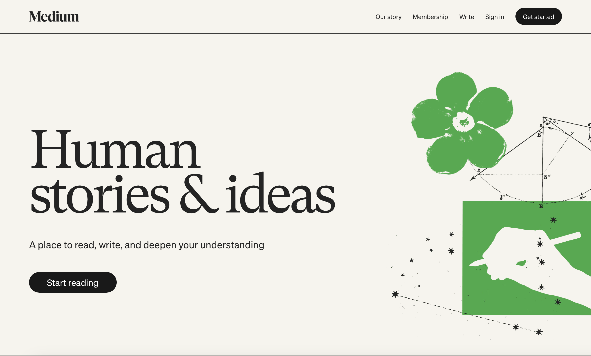

텍스트를 주요 디자인 요소로 활용하여 시각적 계층구조, 정보 전달, 그리고 전반적인 사용자 경험을 형성하는 디자인 접근 방식.
이미지나 장식 대신 글자의 크기, 굵기, 간격, 배치가 화면의 인상을 결정한다.



[타이포그래피]()가 **기법**(글자를 다루는 방법)이라면, 이 글은 글자를 화면의 주인공으로 세우는 **스타일**을 다룬다.

## 특징

- 텍스트를 주요 시각적 요소로 활용
- 다양한 글꼴, 크기, 무게를 통한 시각적 계층 구조 형성
- 여백과 정렬을 통한 가독성 최적화
- 색상과 대비를 활용한 강조와 구분
- 이미지와 그래픽 요소의 제한적 사용
- 큰 제목(display)과 작은 본문의 극단적인 크기 대비

## 역사적 배경

### 등장 시기
20세기 초 모더니즘 운동과 함께 시작, 디지털 시대에 새로운 중요성 획득

### 주요 목적
- 정보의 명확하고 효과적인 전달
- 브랜드 아이덴티티 강화
- 사용자 경험의 일관성 유지

<div class="mermaid">
timeline
  title 타이포그래피 중심 디자인의 발전
  1920 : 바우하우스 운동, 타이포그래피의 중요성 부각
  1950 : 스위스 인터내셔널 스타일, Helvetica 탄생
  1984 : 매킨토시 출시, 디지털 타이포그래피 시대 시작
  2010 : 반응형 웹과 웹 폰트, 유연한 타이포그래피
  2015 : Apple San Francisco 서체 발표, 시스템 전용 서체 시대
  2020 : 가변 폰트 보편화, 정교한 타이포그래피 제어
</div>

## 주요 디자인 요소

- 글꼴 선택과 조합 (보통 한두 가지 서체 패밀리로 제한)
- 글자 크기와 행간 조정
- 글자 색상과 배경의 대비
- 정렬과 여백 활용
- 타이포그래피 계층 구조 설정
- 글자 자체를 그래픽처럼 다루는 레이아웃 (잘림, 겹침, 회전)

## 장단점

### 장점
- 명확하고 직접적인 정보 전달
- 로딩 시간 단축 및 성능 향상 (이미지가 없다)
- 반응형·적응형 레이아웃에 적합
- 강력한 브랜드 아이덴티티 구축 가능
- 현지화해도 디자인이 유지된다 (이미지 속 글자는 번역이 안 된다)

### 단점
- 시각적 다양성 제한 가능성
- 복잡한 정보 전달의 어려움
- 문화적, 언어적 차이로 인한 제약 (한글과 라틴 문자의 밀도 차이)
- 과도한 텍스트로 인한 사용자 피로도 증가 위험
- 글자가 길어지는 언어(독일어 등)에서 레이아웃이 깨질 수 있다

## 대표적 적용 사례

- Medium의 블로그 플랫폼
- Apple의 마케팅 웹페이지와 키노트 슬라이드
- The New York Times 웹사이트
- iOS 설정 앱, 메모 앱처럼 글자만으로 구성된 시스템 앱
- 많은 개인 포트폴리오 및 디자인 에이전시 웹사이트

## 현대 디자인에서의 위치

- 콘텐츠 중심 웹사이트에서 널리 활용
- 미니멀리즘 트렌드와 결합하여 강력한 시너지 효과
- 모바일 퍼스트 디자인 철학과 잘 어울림
- 브랜딩과 UX 디자인의 핵심 요소로 자리잡음

## iOS에서는

### HIG가 말하는 것

iOS는 타이포그래피 중심 플랫폼이다. 시스템 앱의 대부분이 글자만으로 구성되어 있다.
HIG는 이를 가능하게 하는 세 가지 기반을 제공한다.

- **San Francisco(SF) 서체**: 화면용으로 설계된 시스템 서체. SF Pro(iOS/macOS), SF Compact(watchOS), 둥근 SF Pro Rounded, 세리프 New York. 한국어는 Apple SD Gothic Neo가 자동으로 짝지어진다
- **Dynamic Type**: Large Title부터 Caption 2까지 11단계 텍스트 스타일. 사용자가 설정에서 글자 크기를 바꾸면 모든 스타일이 비율을 유지하며 함께 바뀐다
- **큰 제목(Large Title)**: iOS 11부터 내비게이션 바의 큰 제목이 기본이 되면서, 화면 상단이 타이포그래피의 무대가 되었다

HIG의 타이포그래피 중심 디자인은 "큰 글자를 멋지게"가 아니라 **"모든 글자 크기에서 읽히게"**를 뜻한다.

### SwiftUI로 구현하기

**시스템 서체로 디스플레이 타이포그래피**

```swift
struct HeroView: View {
    var body: some View {
        VStack(alignment: .leading, spacing: 4) {
            Text("오늘")
                .font(.system(.largeTitle, design: .serif, weight: .bold))   // New York 세리프
            Text("11월 15일 토요일")
                .font(.title3)
                .foregroundStyle(.secondary)
            Text("3개의 일정이 있습니다")
                .font(.body)
                .padding(.top, 16)
        }
        .frame(maxWidth: .infinity, alignment: .leading)
        .scenePadding()
    }
}
```

**초대형 숫자도 Dynamic Type을 따르게**

```swift
struct BigNumber: View {
    @ScaledMetric(relativeTo: .largeTitle) private var size: CGFloat = 96

    var body: some View {
        Text("24")
            .font(.system(size: size, weight: .thin, design: .rounded))
            .monospacedDigit()
    }
}
```

`@ScaledMetric`을 쓰면 고정 크기처럼 보이는 숫자도 사용자의 글자 크기 설정에 맞춰 커진다.

**커스텀 브랜드 서체**

```swift
extension Font {
    static func brand(_ style: Font.TextStyle) -> Font {
        .custom("Pretendard-SemiBold", size: 17, relativeTo: style)  // Dynamic Type 연동
    }
}
```

### 주의할 점

- **접근성 크기 테스트**: 설정에서 "더 큰 텍스트"를 최대로 올려 본다. 글자가 잘리거나 겹치면 `lineLimit` 제거, `ViewThatFits`로 레이아웃 전환, 또는 `minimumScaleFactor`를 고려한다
- **한글 행간**: SF와 Apple SD Gothic Neo가 섞이면 줄 높이가 달라진다. 한글 비중이 높은 화면은 `lineSpacing`을 한 번 더 확인한다
- **가로 모드와 iPad**: 긴 텍스트 줄은 읽기 어렵다. 본문은 `frame(maxWidth: 680)` 정도로 줄 길이를 제한한다
- **텍스트를 이미지로 넣지 않는다**: 번역, Dynamic Type, VoiceOver 모두 깨진다. 마케팅용 타이포 그래픽도 가능하면 `Text`로 만든다
- **최소 크기**: HIG는 11pt 미만 텍스트를 권하지 않는다. `.caption2`(11pt)가 하한선

## 웹과 iOS 대응표

| 웹 | iOS / SwiftUI |
|---|---|
| `font-family: system-ui` | SF Pro (기본값) |
| `font-family: serif` | `.fontDesign(.serif)` → New York |
| `rem` 단위 크기 | Dynamic Type 텍스트 스타일 |
| `clamp()`로 반응형 폰트 | `@ScaledMetric`, `relativeTo:` |
| `@font-face` | 번들 폰트 + `Font.custom(_:size:relativeTo:)` |
| `max-width: 65ch` | `.frame(maxWidth:)` |
| `font-variant-numeric: tabular-nums` | `.monospacedDigit()` |

## 함께 읽기

- [타이포그래피: 글자를 통한 효과적인 커뮤니케이션]() — 기법으로서의 타이포그래피
- [미니멀리즘 디자인: 적은 것이 더 많은 것이다]()
- [비주얼 계층구조: 시각적 중요도의 체계화]()
