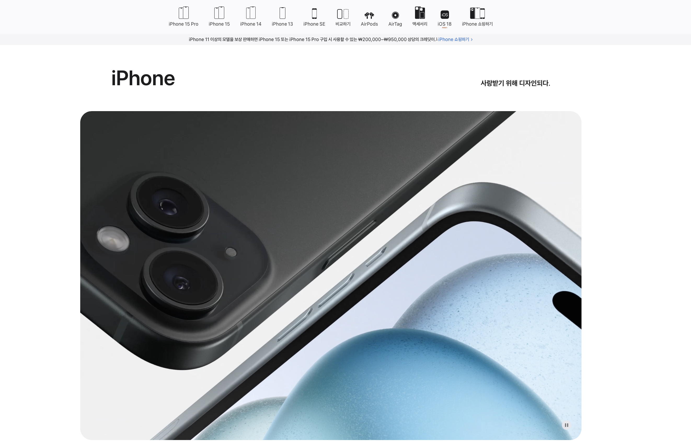

풍부한 시각적 요소를 활용하여 사용자의 관심을 끌고 몰입도 높은 경험을 제공하는 디자인 접근 방식.
미니멀리즘의 반대편에 서서, 고품질 이미지와 영상, 일러스트레이션, 모션으로 화면을 채운다.



# 특징

- 고품질 이미지와 비디오의 적극적 활용
- 복잡하고 상세한 일러스트레이션
- 대담한 색상과 그라데이션
- 동적 요소와 애니메이션 효과
- 텍스처와 패턴의 풍부한 사용
- 3D 요소 및 깊이감 있는 디자인

# 역사적 배경

## 등장 시기
2010년대 중반부터 고성능 디바이스와 고속 인터넷의 보편화로 본격화

## 주요 목적
- 사용자의 시선 집중 및 몰입도 향상
- 브랜드의 독특한 아이덴티티 표현
- 풍부한 시각적 경험을 통한 정보 전달

<div class="mermaid">
timeline
  title 비주얼 리치 디자인의 진화
  2010 : iPhone 4 Retina 디스플레이, 고해상도 시대
  2013 : 반응형 웹 디자인의 대중화
  2015 : 고품질 웹 폰트 및 벡터 그래픽 기술 발전
  2018 : 5G 상용화 시작, 고용량 미디어 사용 가능
  2020 : AR/VR 기술과의 융합 시도
  2023 : AI 생성 이미지 보편화
  2024 : Apple Vision Pro, 공간 컴퓨팅 UI
</div>

# 주요 디자인 요소

- 고해상도 사진 및 비디오
- 복잡한 애니메이션과 전환 효과
- 풍부한 색상 팔레트와 그라데이션
- 다층적 레이아웃과 시차(패럴랙스) 효과
- 상세한 아이콘과 일러스트레이션
- 타이포그래피의 창의적 활용

# 장단점

## 장점
- 강력한 시각적 임팩트 제공
- 사용자 몰입도와 체류 시간 증가
- 브랜드 아이덴티티의 효과적 전달
- 복잡한 정보의 시각화 가능
- 감성적 연결 (여행, 음식, 패션처럼 "보는 것"이 핵심인 분야)

## 단점
- 긴 로딩 시간 및 높은 대역폭 요구
- 과도한 시각 요소로 인한 주의 분산 가능성
- 접근성 문제 (대체 텍스트, 동작 줄이기 대응 필수)
- 디자인 및 유지보수에 높은 비용과 시간 소요
- 배터리 소모와 발열

# 대표적 적용 사례

- Apple의 제품 소개 페이지
- Apple TV+, Apple Music, App Store의 Today 탭
- 디즈니나 픽사의 영화 프로모션 사이트
- 고급 패션 브랜드의 온라인 스토어
- 게임 회사의 공식 웹사이트
- Airbnb, 배달 앱처럼 사진이 상품인 서비스

# 현대 디자인에서의 위치

- 브랜딩과 마케팅에서 강력한 도구로 활용
- 기술 발전에 따라 더욱 정교해지는 추세
- 미니멀리즘과 대비되는 접근으로 차별화 전략에 활용
- AR/VR, 공간 컴퓨팅과의 융합을 통해 새로운 가능성 모색 중

# iOS에서는

## HIG가 말하는 것

HIG는 비주얼 리치를 금지하지 않는다. App Store의 Today 탭이나 Apple TV 앱이 그 증거다. 다만 조건이 붙는다.

- **콘텐츠가 풍부한 것이지 UI가 풍부한 것이 아니다**: 사진과 영상은 크고 선명하게, 그 위의 컨트롤은 최소한으로. UI는 콘텐츠 위에 떠 있는 유리처럼 보여야 한다
- **성능은 디자인의 일부**: 스크롤이 끊기면 아름다움은 의미가 없다. HIG는 60fps(ProMotion 기기에서는 120fps)를 유지하라고 말한다
- **동작 줄이기(Reduce Motion)**: 패럴랙스, 자동 재생, 큰 전환 효과는 이 설정이 켜지면 꺼져야 한다
- **에셋 크기**: 앱 용량과 다운로드 시간도 사용자 경험이다. 앱 시닝(App Thinning)과 온디맨드 리소스를 활용한다

## SwiftUI로 구현하기

**히어로 이미지와 스크롤 연동 효과 (iOS 17+)**

```swift
struct GalleryView: View {
    @Environment(\.accessibilityReduceMotion) private var reduceMotion
    let photos: [Photo]

    var body: some View {
        ScrollView {
            LazyVStack(spacing: 24) {
                ForEach(photos) { photo in
                    AsyncImage(url: photo.url) { image in
                        image.resizable().scaledToFill()
                    } placeholder: {
                        Rectangle().fill(.quaternary)        // 로딩 중 자리 지킴
                    }
                    .containerRelativeFrame(.horizontal)     // 화면 폭에 맞춤
                    .frame(height: 360)
                    .clipShape(RoundedRectangle(cornerRadius: 24))
                    .scrollTransition { content, phase in    // 스크롤에 따라 등장
                        content
                            .opacity(phase.isIdentity ? 1 : 0.6)
                            .scaleEffect(phase.isIdentity || reduceMotion ? 1 : 0.92)
                    }
                    .accessibilityLabel(photo.caption)
                }
            }
            .scenePadding()
        }
    }
}
```

**그라데이션과 셰이더**

```swift
Text("Summer Sale")
    .font(.system(size: 64, weight: .heavy))
    .foregroundStyle(
        LinearGradient(colors: [.orange, .pink, .purple],
                       startPoint: .leading, endPoint: .trailing)
    )
```

iOS 17부터는 `.colorEffect`, `.distortionEffect`, `.layerEffect`로 Metal 셰이더를 뷰에 바로 적용할 수 있어, 물결이나 노이즈 같은 효과도 코드 몇 줄로 가능하다.

## 주의할 점

- **이미지 디코딩**: 큰 이미지를 그대로 `Image`에 넣으면 메모리가 폭발한다. 표시 크기에 맞게 다운샘플링하거나, `AsyncImage` 대신 캐시와 리사이즈를 지원하는 로더를 쓴다
- **동작 줄이기**: `accessibilityReduceMotion`을 읽어 패럴랙스와 자동 재생을 끈다. 위 예시처럼 스케일 효과를 생략한다
- **대체 텍스트**: 장식 이미지는 `.accessibilityHidden(true)`, 의미 있는 이미지는 `accessibilityLabel`. 사진이 핵심 콘텐츠라면 레이블이 곧 콘텐츠다
- **다크 모드**: 밝은 사진 위의 흰 글자는 다크 모드에서도 문제없지만, 어두운 사진 위에는 그라데이션 스크림(scrim)을 깐다
- **배터리**: 반복 애니메이션, 영상 자동 재생은 화면에 보일 때만 돌린다. `onScrollVisibilityChange`(iOS 18)로 보이지 않을 때 멈춘다

# 웹과 iOS 대응표

| 웹 | iOS / SwiftUI |
|---|---|
| `` 반응형 이미지 | 에셋 카탈로그 @2x/@3x, 앱 시닝 |
| `loading="lazy"` | `LazyVStack` + `AsyncImage` |
| CSS 패럴랙스, Intersection Observer | `.scrollTransition`, `.visualEffect` |
| `background-clip: text` 그라데이션 글자 | `.foregroundStyle(LinearGradient(...))` |
| WebGL 셰이더 | Metal 셰이더 (`.colorEffect` 등) |
| `@media (prefers-reduced-motion)` | `accessibilityReduceMotion` |
| `<video autoplay muted>` | `VideoPlayer` + 가시성에 따라 재생 제어 |

# 함께 읽기

- [미니멀리즘 디자인: 적은 것이 더 많은 것이다]() — 정반대의 접근
- [애니메이션과 모션: 동적 사용자 경험의 핵심]()
- [스켈레톤 UI: 로딩의 미학]() — 무거운 콘텐츠의 로딩을 견디게 하는 법
