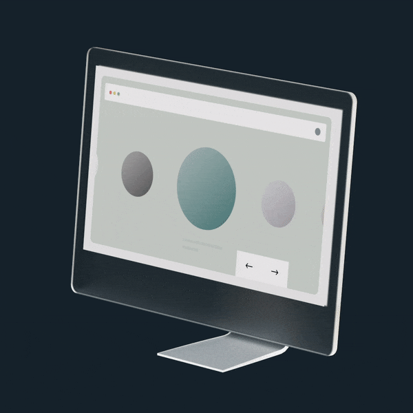

정적인 인터페이스에 생동감을 불어넣는 디자인 요소.
사용자의 주의를 유도하고, 상호작용을 강화하며, 상태 변화를 설명하는 시각적 피드백을 제공한다.



# 특징

- 사용자 행동에 대한 즉각적인 시각적 반응 제공
- 화면 전환 및 상태 변화를 부드럽게 표현
- 사용자의 주의를 중요 정보로 유도
- 브랜드 개성을 표현하는 수단으로 활용
- 복잡한 상호작용을 직관적으로 설명 (어디서 왔고 어디로 가는가)

# 주요 유형

### 기능적 애니메이션
로딩 인디케이터, 진행 상태 표시 등 기능적 목적

### 상태 변화 애니메이션
버튼 클릭, 토글 스위치 전환 등의 상태 변화 표현

### 내비게이션 전환
페이지 간 이동, 메뉴 열기/닫기 등의 전환 효과

### 마이크로인터랙션
작은 요소들의 반응을 통한 세밀한 피드백 제공 ([별도 글]())

### 설명적 애니메이션
복잡한 프로세스나 개념을 시각적으로 설명

# 장점

### 사용성 향상
사용자 행동의 결과를 명확히 전달

### 감성적 만족
부드럽고 세련된 움직임으로 사용 경험 개선

### 브랜드 강화
독특한 모션을 통한 브랜드 아이덴티티 표현

### 사용자 가이드
명시적 설명 없이 인터페이스 사용법 안내

### 주의 집중
중요 정보나 변화에 사용자 주의 유도

# 적용 사례

- 모바일 앱의 화면 전환 효과
- 웹사이트의 스크롤 기반 패럴랙스 효과
- 데스크톱 OS의 창 최소화/최대화 애니메이션
- 소셜 미디어 앱의 '좋아요' 버튼 반응
- 게임 UI의 메뉴 열림/닫힘 효과

# 구현 시 고려사항

### 목적성
장식이 아닌 사용성 향상에 초점

### 성능 최적화
부드러운 실행을 위한 최적화 (60fps 목표, ProMotion 기기는 120fps)

### 타이밍과 속도
자연스럽고 적절한 지속 시간 설정 (UI 전환은 보통 0.2~0.5초)

### 일관성
전체 인터페이스에 걸친 일관된 모션 언어 유지

### 과도한 사용 주의
필요 이상의 애니메이션은 사용성 저하 가능

### 접근성
모션에 민감한 사용자를 위한 제어 옵션 제공

### 컨텍스트 고려
사용 상황에 맞는 적절한 애니메이션 선택

### 중단 가능성
사용자가 애니메이션 도중 다른 동작을 하면 즉시 반응해야 한다

# iOS에서는

## HIG가 말하는 것

iOS는 모션을 가장 적극적으로 쓰는 플랫폼이면서, 동시에 가장 엄격한 기준을 가진 플랫폼이다. HIG의 Motion 페이지는 세 가지를 요구한다.

- **목적이 있어야 한다**: 모션은 "무슨 일이 일어났는지"를 설명해야 한다. 시트가 아래에서 올라오는 것은 "이 화면은 임시이며 아래로 내려 닫을 수 있다"는 설명이다
- **짧고 정확해야 한다**: 사용자를 기다리게 하는 모션은 실패다. 시스템 전환은 대부분 0.35초 안에 끝난다
- **선택적이어야 한다**: "동작 줄이기" 설정이 켜지면 큼직한 이동과 확대는 크로스페이드로 바뀌어야 한다

그리고 iOS 모션의 핵심 특징은 **스프링**이다. iOS의 거의 모든 시스템 애니메이션은 이징 커브가 아닌 스프링 물리를 쓴다. 그래서 중간에 방향을 바꿔도 자연스럽게 이어진다(interruptible).

## SwiftUI로 구현하기

SwiftUI의 애니메이션은 "상태가 바뀌면 그 차이를 애니메이션으로 채운다"는 모델이다. 프레임을 직접 다루지 않는다.

**상태 변화 애니메이션**

```swift
struct ExpandableCard: View {
    @State private var isExpanded = false

    var body: some View {
        VStack(alignment: .leading) {
            Text("제목").font(.headline)
            if isExpanded {
                Text("펼쳐지면 보이는 상세 내용입니다.")
                    .transition(.move(edge: .top).combined(with: .opacity))
            }
        }
        .padding()
        .background(.background, in: RoundedRectangle(cornerRadius: 16))
        .onTapGesture {
            withAnimation(.spring(duration: 0.4, bounce: 0.2)) {   // 스프링이 기본
                isExpanded.toggle()
            }
        }
    }
}
```

**화면 사이를 잇는 전환 (히어로 애니메이션)**

```swift
@Namespace private var hero

// 목록에서
Image(photo.name)
    .matchedGeometryEffect(id: photo.id, in: hero)

// 상세에서 (같은 id, 같은 namespace)
Image(photo.name)
    .matchedGeometryEffect(id: photo.id, in: hero)
```

iOS 18부터는 `NavigationStack`에서도 `.navigationTransition(.zoom(sourceID:in:))`으로 시스템 줌 전환을 쓸 수 있다.

**동작 줄이기 대응**

```swift
@Environment(\.accessibilityReduceMotion) private var reduceMotion

withAnimation(reduceMotion ? .easeInOut(duration: 0.15) : .spring) {
    showDetail = true
}
```

**복잡한 시퀀스 (iOS 17+)**: `PhaseAnimator`는 여러 단계를 순서대로, `KeyframeAnimator`는 속성별 키프레임을 시간축으로 제어한다.

## 주의할 점

- **`withAnimation` vs `.animation(_:value:)`**: 전자는 "이 변경을 애니메이션하라", 후자는 "이 값이 바뀌면 항상 애니메이션하라". 후자는 꼭 `value:`를 지정해 의도치 않은 애니메이션을 막는다
- **레이아웃 애니메이션 비용**: 리스트 전체가 재배치되는 애니메이션은 비싸다. `LazyVStack` 안에서는 셀 단위로 제한한다
- **투명도와 블러**: 큰 뷰의 `.blur`를 애니메이션하면 GPU가 버거워한다. 재질(Material)이나 불투명도로 대체한다
- **중단 가능성**: 스프링을 쓰면 애니메이션 중에 상태를 다시 바꿔도 자연스럽게 이어진다. 커스텀 타이머로 프레임을 돌리면 이 특성을 잃는다
- **Xcode에서 확인**: 시뮬레이터의 Debug > Slow Animations로 타이밍을, 설정 > 손쉬운 사용 > 동작 줄이기로 대체 모션을 점검한다

# 웹과 iOS 대응표

| 웹 | iOS / SwiftUI |
|---|---|
| CSS `transition` | `.animation(_:value:)` |
| JS로 트리거하는 애니메이션 | `withAnimation { }` |
| `cubic-bezier()` 이징 | `.easeInOut`, `.spring(duration:bounce:)` |
| CSS `@keyframes` | `KeyframeAnimator`, `PhaseAnimator` |
| View Transitions API / FLIP | `matchedGeometryEffect`, `.navigationTransition(.zoom)` |
| `@media (prefers-reduced-motion)` | `accessibilityReduceMotion` |
| `requestAnimationFrame` | `TimelineView` (필요할 때만) |

# 함께 읽기

- [마이크로인터랙션: 작은 디테일의 큰 영향]() — 모션의 가장 작은 단위
- [제스처 기반 인터페이스: 직관적 조작의 혁신]() — 모션을 손가락이 끌고 가는 경우
- [머티리얼 디자인: 디지털 세계의 물리적 메타포]() — 모션을 시스템의 축으로 세운 사례
