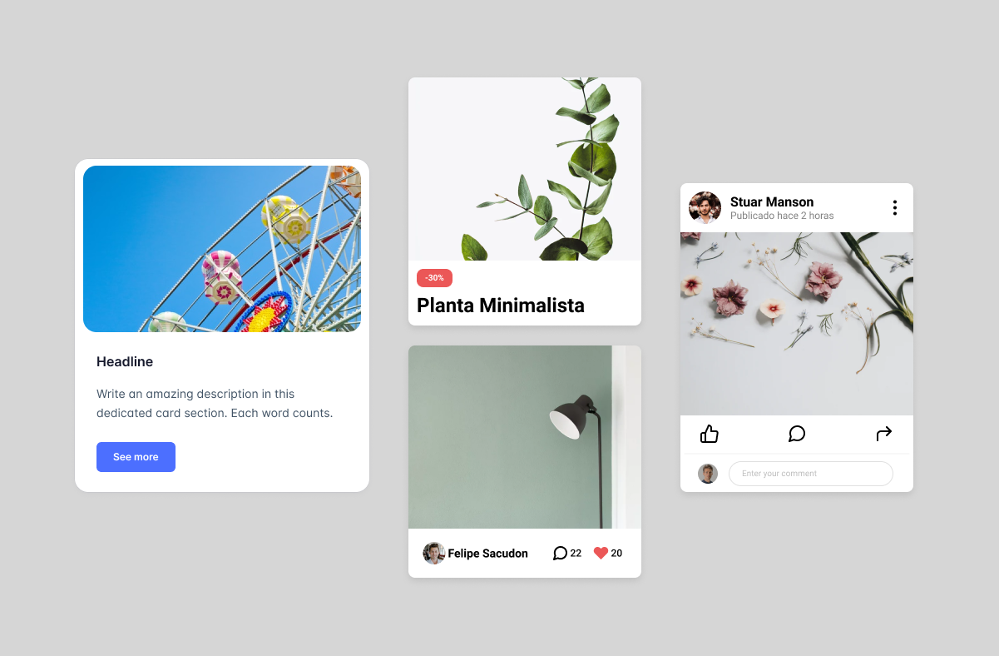

정보를 독립적이고 일관된 직사각형 유닛(카드)으로 표현하는 디자인 패턴.
콘텐츠를 명확하게 구분하고 사용자 상호작용을 촉진하는 데 효과적이다.



# 특징

- 정보를 독립적인 카드 형태로 분할
- 일관된 크기와 디자인으로 시각적 통일성 제공
- 그림자, 경계선, 배경색 차이로 카드 간 구분 강화
- 반응형 레이아웃에 적합한 유연한 구조 (카드는 재배치가 쉽다)
- 터치 인터페이스에 최적화된 상호작용 디자인 (카드 전체가 탭 영역)

# 장점

- **정보 구조화**: 복잡한 정보를 쉽게 이해할 수 있는 단위로 분할
- **스캔 용이성**: 사용자가 빠르게 내용을 훑어볼 수 있음
- **모바일 친화적**: 터치 기반 인터페이스에 적합한 크기와 레이아웃
- **확장성**: 새로운 콘텐츠를 쉽게 추가하고 재배열 가능
- **일관성**: 다양한 유형의 콘텐츠를 일관된 형식으로 표현
- **이종 콘텐츠 혼합**: 기사, 광고, 추천을 한 피드에 섞을 수 있다

# 적용 사례

- 소셜 미디어 피드 (Pinterest, X)
- 뉴스 애플리케이션의 기사 목록
- 이커머스 플랫폼의 상품 진열
- 대시보드의 데이터 위젯 표시
- App Store Today 탭, Apple 뉴스, 지갑 앱

# 주의사항

### 정보 밀도
카드 내 정보량 조절로 가독성 유지

### 일관성 유지
카드 디자인과 레이아웃의 일관성 확보

### 성능 최적화
다수의 카드 렌더링 시 성능 고려 (지연 로딩 등 활용)

### 접근성
스크린 리더 사용자를 위한 적절한 구조와 레이블 제공

### 오버디자인 주의
과도한 시각적 요소로 인한 복잡성 증가 방지

### 내용 적합성
모든 정보가 카드 형태에 적합한 것은 아님을 인지. 균일한 목록은 리스트가 낫다

### 터치 영역 최적화
모바일 환경에서 충분한 터치 영역 확보

### 카드 간 구분
배경과 카드, 카드 간의 명확한 구분 제공

# iOS에서는

## HIG가 말하는 것

HIG에는 "Card"라는 독립 컴포넌트가 없다. 대신 카드 역할을 하는 것들이 여럿 있다.

- **인셋 그룹 리스트**: 설정 앱의 둥근 섹션들이 사실상 카드다. 균일한 항목 목록은 이것으로 충분하다
- **위젯**: 홈 화면 위젯은 iOS에서 가장 엄격하게 정의된 카드다. 크기가 정해져 있고(소/중/대), 모서리 반경이 시스템과 맞고, 콘텐츠가 가장자리까지 간다
- **App Store Today 카드**: 큰 이미지 + 제목 + 탭하면 확대되어 상세로 전환. iOS 카드 UI의 원형
- **시트(Sheet)**: 아래에서 올라오는 모달도 "카드"로 불린다. 뒤 화면이 살짝 줄어들어 카드가 위에 얹힌 느낌을 준다

HIG의 공통 원칙은 **카드는 콘텐츠의 단위이고, 컨테이너가 콘텐츠보다 눈에 띄면 안 된다**는 것이다. 그림자는 절제하고, 모서리 반경은 시스템과 맞추고(대개 10~16pt), 배경과의 구분은 색 한 단계 차이로 한다.

## SwiftUI로 구현하기

**균일한 목록은 리스트로**

```swift
List {
    Section {
        ForEach(devices) { device in
            LabeledContent(device.name, value: device.status)
        }
    } header: {
        Text("연결된 기기")
    }
}
.listStyle(.insetGrouped)        // 섹션이 곧 카드
```

**콘텐츠 카드**

```swift
struct ArticleCard: View {
    let article: Article

    var body: some View {
        VStack(alignment: .leading, spacing: 0) {
            AsyncImage(url: article.image) { $0.resizable().scaledToFill() }
                placeholder: { Color(.tertiarySystemFill) }
                .frame(height: 180)
                .clipped()

            VStack(alignment: .leading, spacing: 6) {
                Text(article.category.uppercased())
                    .font(.caption2.weight(.semibold))
                    .foregroundStyle(.tint)
                Text(article.title)
                    .font(.headline)
                Text(article.summary)
                    .font(.subheadline)
                    .foregroundStyle(.secondary)
                    .lineLimit(2)
            }
            .padding(16)
        }
        .background(Color(.secondarySystemGroupedBackground))
        .clipShape(RoundedRectangle(cornerRadius: 16, style: .continuous))   // iOS식 둥근 모서리
        .shadow(color: .black.opacity(0.08), radius: 10, y: 4)
        .accessibilityElement(children: .combine)          // 카드 전체를 하나로 읽음
    }
}
```

`style: .continuous`는 iOS 아이콘과 같은 매끈한 곡선(squircle)을 만든다. 시스템 UI와 어울리려면 이 옵션을 켠다.

**탭하면 상세로 (히어로 전환, iOS 18+)**

```swift
@Namespace private var ns

NavigationLink(value: article) {
    ArticleCard(article: article)
        .matchedTransitionSource(id: article.id, in: ns)
}
.buttonStyle(.plain)

// 상세 화면에서
DetailView(article: article)
    .navigationTransition(.zoom(sourceID: article.id, in: ns))
```

**가로 스크롤 카드 (iOS 17+)**

```swift
ScrollView(.horizontal) {
    HStack(spacing: 16) {
        ForEach(items) { ArticleCard(article: $0).containerRelativeFrame(.horizontal, count: 1, span: 1, spacing: 16) }
    }
    .scrollTargetLayout()
}
.scrollTargetBehavior(.viewAligned)      // 카드 단위로 스냅
.contentMargins(.horizontal, 20)
```

## 주의할 점

- **접근성 묶기**: 카드 안의 이미지, 제목, 요약을 VoiceOver가 따로 읽으면 피곤하다. `.accessibilityElement(children: .combine)`으로 하나로 묶고, 버튼이면 `.isButton` 트레이트를 준다
- **카드 안의 버튼**: 카드 전체가 탭 가능하면서 안에 "좋아요" 버튼이 있으면 제스처가 충돌한다. 안쪽 버튼에 `.buttonStyle(.borderless)`를 주면 리스트 셀 안에서도 따로 동작한다
- **그림자 비용**: `LazyVStack` 셀마다 `.shadow`를 주면 스크롤이 무거워진다. 배경색 한 단계 차이로 구분하고 그림자는 생략하는 쪽이 iOS답다
- **다크 모드**: 그림자는 다크 모드에서 보이지 않는다. 다크 모드에서는 `secondarySystemGroupedBackground`처럼 배경보다 밝은 색으로 구분한다
- **카드 폭**: iPad에서 카드 하나가 화면 폭 전체를 차지하면 어색하다. `LazyVGrid(.adaptive)`로 열 수를 늘리거나 `maxWidth`를 둔다
- **Dynamic Type**: 카드 높이를 고정하면 큰 글자에서 잘린다. `frame(height:)`는 이미지에만, 텍스트 영역은 내용에 맞게

# 웹과 iOS 대응표

| 웹 | iOS / SwiftUI |
|---|---|
| `<div class="card">` + `border-radius` + `box-shadow` | `background` + `clipShape(RoundedRectangle(style: .continuous))` |
| 카드 그룹 `<ul>` | `.listStyle(.insetGrouped)` |
| `role="button"` 카드 전체 링크 | `NavigationLink` + `.buttonStyle(.plain)` |
| 캐러셀 라이브러리 | `ScrollView(.horizontal)` + `.scrollTargetBehavior(.viewAligned)` |
| View Transitions로 카드 → 상세 | `matchedTransitionSource` + `.navigationTransition(.zoom)` |
| `aria-label`로 카드 요약 | `.accessibilityElement(children: .combine)` |
| CSS Grid 카드 그리드 | `LazyVGrid(columns: [.adaptive(minimum:)])` |

# 함께 읽기

- [그리드 시스템: 디자인의 골격]() — 카드를 배치하는 틀
- [비주얼 계층구조: 시각적 중요도의 체계화]() — 카드 안의 위계
- [스켈레톤 UI: 로딩의 미학]() — 카드가 로딩 중일 때
