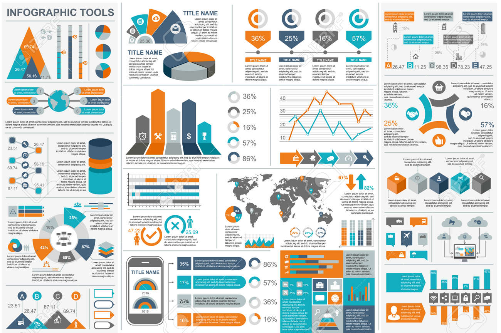

복잡한 데이터를 그래픽 요소를 사용하여 시각적으로 표현하는 기법.
대량의 정보를 쉽게 이해하고 분석할 수 있도록 도와주는 효과적인 커뮤니케이션 도구다.



# 특징

- 복잡한 데이터셋을 직관적으로 표현
- 패턴, 트렌드, 상관관계를 쉽게 식별 가능
- 인터랙티브 요소를 통한 심층 탐색 지원
- 색상, 형태, 크기 등을 활용한 다차원 정보 표현
- 스토리텔링과 결합하여 강력한 인사이트 전달

# 주요 유형

### 차트와 그래프
막대 그래프, 선 그래프, 원 차트 등 기본적인 데이터 표현

### 지도 기반 시각화
지리적 데이터를 지도 위에 표현

### 인포그래픽
정보와 그래픽을 결합한 시각적 요약

### 대시보드
여러 데이터 시각화를 한 화면에 통합 표시

### 네트워크 다이어그램
관계와 연결을 표현하는 노드-링크 구조

### 스파크라인
축과 레이블 없이 추세만 보여 주는 작은 선 그래프. 목록 셀이나 위젯에 들어간다

# 장점

### 빠른 정보 파악
복잡한 데이터셋을 한눈에 이해 가능

### 패턴 발견
대량의 데이터에서 숨겨진 패턴과 트렌드 식별

### 의사결정 지원
데이터 기반의 신속하고 정확한 의사결정 촉진

### 커뮤니케이션 향상
복잡한 개념을 쉽게 설명하고 공유

### 사용자 참여 증대
인터랙티브 요소를 통한 적극적인 데이터 탐색 유도

# 적용 사례

- 비즈니스 인텔리전스 대시보드
- 과학 연구 결과 보고서
- 일기 예보 및 기상 데이터 표현
- 선거 결과 실시간 시각화
- 건강 앱의 활동 링, 수면 그래프, 심박수 차트
- 주식 앱의 가격 차트, 배터리 사용 기록

# 구현 시 고려사항

### 데이터 정확성
원본 데이터의 무결성과 정확한 표현 확보. 축을 잘라 차이를 과장하지 않는다

### 목적 명확성
시각화의 목적과 대상 사용자 명확히 정의

### 적절한 차트 선택
데이터 특성에 맞는 최적의 시각화 유형 선택. 비교는 막대, 추세는 선, 구성은 (조각이 적을 때만) 원

### 색상 사용
의미 전달과 가독성을 고려한 전략적 색상 활용. 범주형은 구분되는 색, 순서형은 한 색의 농도

### 단순화
필수 정보에 집중하고 불필요한 시각적 요소(차트 정크) 제거

### 인터랙티비티
사용자가 데이터를 탐색할 수 있는 인터랙티브 기능 제공

### 접근성
색만으로 구분하지 않기, 대체 텍스트, 데이터 표 제공

### 반응형 디자인
다양한 기기와 화면 크기에서의 최적화된 표시

# iOS에서는

## HIG가 말하는 것

HIG의 Charts 페이지는 Apple이 건강, 주식, 날씨 앱에서 쌓은 원칙을 정리한 것이다.

- **차트 하나에 메시지 하나**: 무엇을 보여 주려는지 한 문장으로 말할 수 없으면 차트를 나눈다
- **설명을 곁들인다**: 차트 위에 "이번 주 평균 7시간 12분"처럼 핵심 수치를 텍스트로 쓴다. 차트는 그 수치의 맥락이다
- **두 가지 밀도**: 요약 차트(위젯, 목록 셀에 들어가는 작은 것. 축과 레이블 없음)와 상세 차트(전체 화면, 축·레이블·범례·탐색 가능)
- **접근성**: 모든 차트는 VoiceOver로 읽을 수 있어야 한다. iOS에는 차트를 소리로 들려주는 **Audio Graph** 기능이 있다
- **색**: 시스템 색상을 쓰고, 색만으로 계열을 구분하지 않는다. 모양이나 패턴을 더한다
- **인터랙션**: 길게 누르거나 드래그하면 그 지점의 값을 보여 주는 룰(rule)과 주석이 iOS 차트의 표준 탐색 방식이다

## SwiftUI로 구현하기

iOS 16부터 **Swift Charts**가 시스템 프레임워크로 들어왔다. SwiftUI와 같은 선언형 문법이고, 접근성과 Dynamic Type, 다크 모드가 기본이다.

**기본 막대 차트**

```swift
import Charts

struct WeeklySteps: View {
    let data: [DailySteps]   // date, steps

    var body: some View {
        Chart(data) { day in
            BarMark(
                x: .value("날짜", day.date, unit: .day),
                y: .value("걸음", day.steps)
            )
            .foregroundStyle(day.steps >= 10_000 ? .green : .secondary)
        }
        .chartYAxis { AxisMarks(position: .leading) }
        .frame(height: 220)
    }
}
```

**요약용 스파크라인 (축 없이)**

```swift
Chart(prices) { point in
    LineMark(x: .value("시각", point.time), y: .value("가격", point.value))
        .interpolationMethod(.catmullRom)
}
.chartXAxis(.hidden)
.chartYAxis(.hidden)
.frame(width: 80, height: 32)
.accessibilityLabel("최근 7일 가격 추세, \(trendDescription)")   // 스파크라인은 설명으로 대체
```

**여러 계열: 색 + 모양**

```swift
Chart(readings) { r in
    LineMark(x: .value("날짜", r.date), y: .value("값", r.value))
        .foregroundStyle(by: .value("종류", r.kind))
        .symbol(by: .value("종류", r.kind))        // 색각 이상 대비: 점 모양도 다르게
}
.chartForegroundStyleScale([
    "수축기": Color.red, "이완기": Color.blue
])
```

**탐색: 드래그하면 값 표시 (iOS 17+)**

```swift
@State private var selectedDate: Date?

Chart(data) { day in
    BarMark(x: .value("날짜", day.date, unit: .day), y: .value("걸음", day.steps))
    if let selectedDate, Calendar.current.isDate(selectedDate, inSameDayAs: day.date) {
        RuleMark(x: .value("선택", selectedDate))
            .annotation(position: .top) {
                Text(day.steps, format: .number).font(.caption.bold())
                    .padding(6).background(.regularMaterial, in: Capsule())
            }
    }
}
.chartXSelection(value: $selectedDate)
.sensoryFeedback(.selection, trigger: selectedDate)
```

**Audio Graph**: Swift Charts는 `AXChartDescriptor`를 자동으로 생성해 VoiceOver의 Audio Graph(로터에서 "오디오 그래프")로 데이터를 소리로 들려준다. 커스텀 차트를 그렸다면 `accessibilityChartDescriptor`로 직접 제공한다.

## 주의할 점

- **Swift Charts를 먼저 고려한다**: `Canvas`나 `Path`로 직접 그리면 접근성, 애니메이션, Dynamic Type을 다 다시 만들어야 한다
- **색만 쓰지 않는다**: `.symbol(by:)`, `.lineStyle(by:)`로 모양이나 선 종류도 함께 바꾼다. 설정의 "색상 없이 구별"을 켠 사용자를 위해서다
- **글자 크기**: 차트 축 레이블도 Dynamic Type을 따른다. 큰 글자에서는 레이블이 겹치므로 `AxisMarks(values: .stride(by: .day, count: 2))`처럼 개수를 줄인다
- **다크 모드**: 시스템 색상(`.blue`, `.green`)과 `.secondary`를 쓰면 자동이다. 고정 RGB 값은 다크 모드에서 눈을 찌른다
- **위젯 차트**: 위젯은 인터랙션이 없으므로 요약 차트만. 상세는 앱에서
- **성능**: 수천 개 점을 `LineMark`로 그리면 느리다. 표시 해상도에 맞게 데이터를 미리 다운샘플링한다
- **숫자 포맷**: `Text(value, format: .number)`, `.currency(code:)`, `.percent`를 쓰면 지역 설정에 맞는 구분 기호가 자동 적용된다

# 웹과 iOS 대응표

| 웹 | iOS / SwiftUI |
|---|---|
| Chart.js, Recharts, D3 | Swift Charts |
| `<canvas>` 직접 그리기 | `Canvas`, `Path` (최후의 수단) |
| 툴팁 (hover) | `chartXSelection` + `RuleMark` + `annotation` |
| 범례 `<legend>` | `.chartLegend`, `.chartForegroundStyleScale` |
| `aria-label` + 데이터 표 | 자동 `AXChartDescriptor`, Audio Graph |
| 반응형 `width: 100%` | `.frame(maxWidth: .infinity)` + `containerRelativeFrame` |
| 축 레이블 폰트 설정 | Dynamic Type 자동, `AxisMarks` 개수 조정 |
| `Intl.NumberFormat` | `.formatted()`, `FormatStyle` |

# 함께 읽기

- [비주얼 계층구조: 시각적 중요도의 체계화]() — 핵심 수치와 차트의 위계
- [카드 기반 디자인: 정보의 모듈화]() — 대시보드 위젯
- [타이포그래피: 글자를 통한 효과적인 커뮤니케이션]() — 숫자 폭 고정과 포맷
