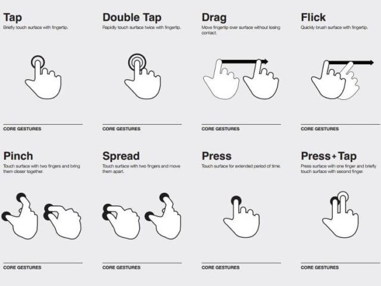

사용자의 신체 동작을 인식하여 기기를 조작하는 인터페이스 방식.
터치, 스와이프, 핀치 등의 제스처를 통해 자연스럽고 직관적인 상호작용을 제공한다.



# 특징

- 물리적 버튼 의존도 감소
- 자연스럽고 유기적인 사용자 경험 제공
- 화면 공간의 효율적 활용
- 학습 곡선 감소로 사용성 향상 (단, 표준 제스처에 한해)
- 다양한 상호작용 방식 지원

# 주요 제스처 유형

### 탭 (Tap)
화면을 빠르게 터치하여 선택 또는 활성화

### 스와이프 (Swipe)
화면을 가로나 세로로 밀어 스크롤하거나 페이지 전환

### 핀치 (Pinch)
두 손가락을 모으거나 벌려 확대/축소

### 롱 프레스 (Long Press)
화면을 길게 눌러 추가 옵션 표시

### 드래그 (Drag)
요소를 눌러 끌어서 이동

### 회전 (Rotate)
두 손가락으로 회전하여 이미지나 객체 회전

# 장점

### 직관성
자연스러운 동작으로 쉽게 이해하고 사용 가능

### 몰입감
물리적 제약 없이 콘텐츠와 직접 상호작용

### 화면 공간 최적화
UI 요소를 줄여 콘텐츠에 집중할 수 있는 환경 제공

### 다기능성
다양한 제스처로 복잡한 기능도 간단히 수행

### 사용자 만족도 증가
신체적 움직임을 통한 상호작용으로 만족감 향상

# 적용 사례

- 스마트폰의 스와이프 기반 네비게이션
- 태블릿의 멀티터치 제스처를 활용한 그림 앱
- 스마트워치의 회전 베젤·크라운 인터페이스
- 게임 콘솔의 모션 컨트롤러
- AR/VR 환경에서의 손동작 인식 인터페이스 (visionOS의 시선 + 핀치)

# 구현 시 고려사항

### 일관성
OS 및 플랫폼의 표준 제스처 가이드라인 준수

### 피드백
제스처 인식 및 실행에 대한 명확한 시각적/촉각적 피드백 제공

### 오류 허용
부정확한 제스처에 대한 관용적 처리

### 접근성
신체적 제약이 있는 사용자를 위한 대체 인터페이스 제공

### 학습 용이성
복잡한 제스처의 경우 튜토리얼이나 힌트 제공

### 발견 가능성
보이지 않는 제스처는 사용자가 모른다. 중요한 기능은 보이는 버튼도 함께 둔다

### 피로도 감소
장시간 사용 시 피로를 최소화하는 자연스러운 동작 설계

# iOS에서는

## HIG가 말하는 것

iOS는 제스처로 움직이는 플랫폼이다. 홈 버튼이 사라진 뒤로는 더 그렇다. HIG의 핵심 메시지는 두 가지다.

**1. 표준 제스처를 바꾸지 말라**

사용자는 OS 전체에서 같은 제스처가 같은 결과를 낼 것으로 기대한다.

| 제스처 | 시스템 의미 |
|---|---|
| 왼쪽 가장자리에서 스와이프 | 뒤로 가기 |
| 아래 가장자리에서 위로 | 홈 / 앱 전환 |
| 위 가장자리에서 아래로 | 알림 센터 / 컨트롤 센터 |
| 시트를 아래로 끌기 | 닫기 |
| 리스트 행을 좌우로 스와이프 | 행 동작 (삭제, 보관 등) |
| 아래로 당기기 | 새로 고침 |
| 길게 누르기 | 컨텍스트 메뉴 |
| 핀치 | 확대/축소 |

앱이 이 제스처들을 다른 의미로 가로채면 사용자는 앱이 "고장났다"고 느낀다.

**2. 제스처는 지름길이지 유일한 길이 아니다**

HIG는 모든 제스처 기능에 **보이는 대안**을 요구한다. 스와이프로 삭제할 수 있어도 편집 모드의 삭제 버튼이 있어야 하고, 핀치로 확대할 수 있어도 확대 버튼이나 더블 탭이 있어야 한다.
VoiceOver, 스위치 제어, AssistiveTouch 사용자는 복잡한 제스처를 쓸 수 없다.

## SwiftUI로 구현하기

**시스템 제스처는 컴포넌트에 내장되어 있다**

```swift
List {
    ForEach(items) { item in
        Text(item.title)
            .swipeActions(edge: .trailing) {               // 스와이프 동작
                Button(role: .destructive) { delete(item) } label: {
                    Label("삭제", systemImage: "trash")
                }
            }
            .contextMenu {                                 // 길게 누르기
                Button("공유", systemImage: "square.and.arrow.up") { }
            }
    }
}
.refreshable { await reload() }                            // 당겨서 새로 고침
```

**커스텀 제스처: 드래그로 카드 넘기기**

```swift
struct SwipeCard: View {
    @State private var offset: CGSize = .zero
    @State private var dismissed = false
    var onDismiss: () -> Void

    var body: some View {
        CardContent()
            .offset(offset)
            .rotationEffect(.degrees(offset.width / 20))
            .gesture(
                DragGesture()
                    .onChanged { offset = $0.translation }
                    .onEnded { value in
                        if abs(value.translation.width) > 120 {
                            withAnimation(.spring) {
                                offset.width = value.translation.width > 0 ? 600 : -600
                            }
                            dismissed = true
                            onDismiss()
                        } else {
                            withAnimation(.spring) { offset = .zero }   // 임계점 미달이면 복귀
                        }
                    }
            )
            .sensoryFeedback(.impact, trigger: dismissed)
            .accessibilityAction(named: "다음으로 넘기기") { onDismiss() }   // 제스처 대안
    }
}
```

**확대/축소와 회전 (iOS 17+)**

```swift
Image("map")
    .scaleEffect(scale)
    .rotationEffect(angle)
    .gesture(
        MagnifyGesture()
            .onChanged { scale = $0.magnification }
            .simultaneously(with: RotateGesture()
                .onChanged { angle = $0.rotation })
    )
```

## 주의할 점

- **가장자리 충돌**: 화면 왼쪽 가장자리의 가로 드래그는 시스템의 뒤로 가기와 경쟁한다. 가장자리에서 20pt 정도는 비워 두거나 `DragGesture(minimumDistance:)`로 임계값을 둔다
- **스크롤과의 경쟁**: `ScrollView` 안의 세로 드래그 제스처는 스크롤에 먹힌다. 가로 제스처로 제한하거나 `.highPriorityGesture`를 신중하게 쓴다
- **임계값과 복귀**: 제스처가 임계점에 못 미치면 원위치로 돌아가는 애니메이션을 꼭 넣는다. 그래야 "취소할 수 있다"는 안전감이 생긴다
- **접근성 대안**: `accessibilityAction`으로 VoiceOver 사용자에게 같은 기능을 제공한다. 시스템 제스처(스와이프 동작, 컨텍스트 메뉴)는 자동으로 처리된다
- **발견 가능성**: 숨은 제스처는 첫 사용 시 짧은 힌트(TipKit, iOS 17+)로 알려 주거나, 살짝 움직여 보여 주는(peek) 애니메이션을 넣는다
- **iPad 포인터와 키보드**: 제스처만 있으면 트랙패드·키보드 사용자가 막힌다. 메뉴 명령과 키보드 단축키를 함께 제공한다

# 웹과 iOS 대응표

| 웹 | iOS / SwiftUI |
|---|---|
| `touchstart/move/end` 이벤트 | `DragGesture` |
| Hammer.js 같은 제스처 라이브러리 | `Gesture` 프로토콜 (`Tap`, `LongPress`, `Drag`, `Magnify`, `Rotate`) |
| `touch-action: pan-y` | 제스처 축 제한, `highPriorityGesture` |
| 스와이프 삭제 직접 구현 | `.swipeActions` |
| 길게 눌러 메뉴 직접 구현 | `.contextMenu` |
| 당겨서 새로 고침 직접 구현 | `.refreshable` |
| 키보드 대안 (`tabindex`, 버튼) | `accessibilityAction`, 보이는 버튼 |

# 함께 읽기

- [애니메이션과 모션: 동적 사용자 경험의 핵심]() — 제스처가 끌고 가는 모션
- [마이크로인터랙션: 작은 디테일의 큰 영향]() — 제스처에 대한 피드백
- [카드 기반 디자인: 정보의 모듈화]() — 제스처의 단골 대상
