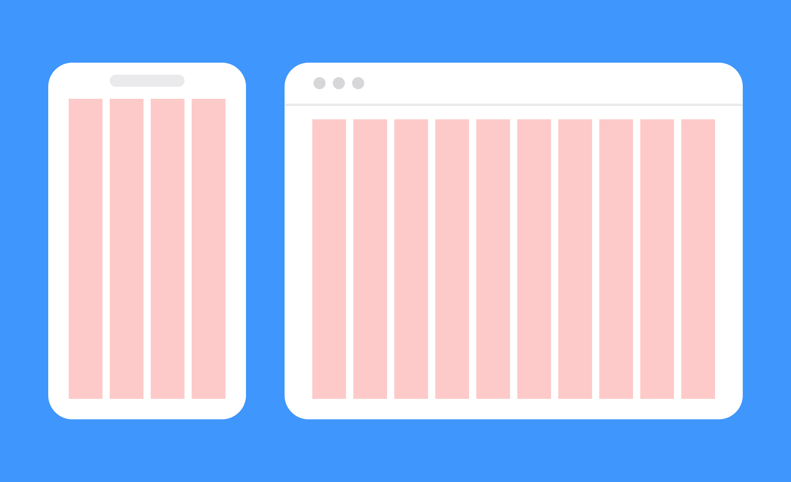

시각적 요소를 체계적으로 배치하기 위한 구조적 프레임워크.
보이지 않는 선들이 콘텐츠를 정렬해 일관성 있고 균형 잡힌 레이아웃을 만든다.



## 특징

- 수평 및 수직선으로 구성된 보이지 않는 구조
- 콘텐츠를 논리적이고 일관된 방식으로 정렬
- 다양한 화면 크기에 대응하는 유연한 레이아웃 지원
- 디자인 요소 간의 관계와 계층 구조 정립
- 시각적 복잡성을 줄이고 가독성 향상

## 주요 구성 요소

#### 컬럼 (Columns)
콘텐츠가 배치되는 세로 영역

#### 거터 (Gutters)
컬럼 사이의 간격

#### 마진 (Margins)
레이아웃의 좌우 가장자리 여백

#### 모듈 (Modules)
컬럼과 행의 교차점으로 만들어지는 단위 공간

#### 필드 (Fields)
여러 모듈이 모여 형성되는 콘텐츠 영역

#### 기준 단위 (Base Unit)
모든 간격의 배수가 되는 수치. 8pt 그리드가 가장 흔하다

## 장점

#### 일관성
디자인 전반에 걸친 시각적 일관성 유지

#### 효율성
레이아웃 결정 과정 간소화 및 작업 시간 단축

#### 유연성
다양한 콘텐츠 유형과 화면 크기에 적응 가능

#### 가독성
정보의 논리적 구조화로 사용자의 이해도 향상

#### 협업 용이성
디자이너와 개발자 간 명확한 커뮤니케이션 지원 ("16pt 띄워"가 "적당히 띄워"보다 낫다)

## 적용 사례

- 웹사이트 레이아웃 디자인 (12컬럼 그리드)
- 모바일 앱 인터페이스 구성
- 인쇄 매체 (잡지, 브로슈어 등) 레이아웃
- 대시보드 UI 설계
- 사진 갤러리, 상품 목록

## 구현 시 고려사항

#### 콘텐츠 우선
그리드에 맞추기 위해 콘텐츠를 왜곡하지 않도록 주의

#### 유연성
고정 그리드와 유동 그리드의 적절한 활용

#### 계층 구조
시각적 중요도에 따른 요소 배치

#### 반응형 설계
다양한 기기에 대응하는 브레이크포인트 설정

#### 가독성
적절한 행 길이와 여백 유지

#### 시각적 흥미
단조로움을 피하기 위한 의도적인 그리드 파괴 고려

#### 접근성
그리드 구조가 스크린 리더의 읽기 순서를 어지럽히지 않도록 주의

#### 일관성 유지
전체 디자인에 걸쳐 동일한 그리드 시스템 적용

## iOS에서는

### HIG가 말하는 것

웹의 "12컬럼 그리드"는 iOS에 그대로 존재하지 않는다. iPhone 화면은 컬럼을 나눌 만큼 넓지 않고, 대신 HIG는 다른 기준선을 제시한다.

- **레이아웃 마진**: 화면 가장자리에서 콘텐츠까지의 기본 여백. iPhone에서 16pt, 큰 화면에서 20pt. 시스템 컨트롤(내비게이션 바 제목, 리스트 셀 텍스트)이 모두 이 선에 맞춰 있다
- **세이프 에어리어(Safe Area)**: 노치, 다이내믹 아일랜드, 홈 인디케이터, 바를 피한 영역. 그리드의 바깥 테두리다
- **44pt**: 최소 터치 영역. 행 높이와 버튼 크기의 기준이 된다
- **8pt 리듬**: 명시적 규정은 아니지만 시스템 컨트롤의 간격이 대부분 8의 배수(8, 16, 20, 44)로 되어 있다
- **iPad의 컬럼**: 화면이 넓어지면 `NavigationSplitView`의 사이드바-콘텐츠-상세 세 컬럼이 그리드 역할을 한다

핵심은 **시스템이 이미 그려 놓은 선에 맞추는 것**이다. 리스트 셀의 텍스트 시작점과 내비게이션 제목의 시작점이 같은 세로선 위에 있을 때 화면이 정돈되어 보인다.

### SwiftUI로 구현하기

**적응형 그리드 (갤러리)**

```swift
ScrollView {
    LazyVGrid(
        columns: [GridItem(.adaptive(minimum: 150), spacing: 16)],  // 폭에 맞춰 열 수 자동
        spacing: 16
    ) {
        ForEach(photos) { photo in
            PhotoCell(photo: photo)
                .aspectRatio(1, contentMode: .fit)
        }
    }
    .scenePadding(.horizontal)                                       // 시스템 레이아웃 마진
}
```

`.adaptive(minimum:)`은 iPhone에서 2열, iPad에서 5~6열로 자동 조정된다. 브레이크포인트를 쓰지 않는다.

**고정 열 수**

```swift
let columns = Array(repeating: GridItem(.flexible(), spacing: 12), count: 3)
LazyVGrid(columns: columns, spacing: 12) { ... }
```

**정렬이 중요한 표 형태 (iOS 16+)**

```swift
Grid(alignment: .leading, horizontalSpacing: 16, verticalSpacing: 8) {
    GridRow {
        Text("항목").font(.caption).foregroundStyle(.secondary)
        Text("수량").font(.caption).foregroundStyle(.secondary)
        Text("금액").font(.caption).foregroundStyle(.secondary)
    }
    Divider()
    ForEach(lines) { line in
        GridRow {
            Text(line.name)
            Text(line.qty, format: .number).gridColumnAlignment(.trailing)
            Text(line.price, format: .currency(code: "KRW")).gridColumnAlignment(.trailing)
        }
    }
}
```

`Grid`는 `LazyVGrid`와 달리 열 폭을 내용에 맞춰 계산하므로 표처럼 세로 정렬이 맞는다.

**8pt 리듬을 상수로**

```swift
enum Spacing {
    static let xs: CGFloat = 4
    static let s: CGFloat = 8
    static let m: CGFloat = 16
    static let l: CGFloat = 24
    static let xl: CGFloat = 32
}
```

### 주의할 점

- **`LazyVGrid` vs `Grid`**: 전자는 스크롤되는 많은 셀에, 후자는 한 화면에 들어오는 표 레이아웃에. `Grid`는 지연 로딩이 없어 셀이 수백 개면 느리다
- **세이프 에어리어 무시 금지**: `.ignoresSafeArea()`는 배경에만 쓴다. 콘텐츠가 다이내믹 아일랜드 아래로 들어가면 안 된다
- **Dynamic Type**: 글자가 커지면 열 수가 줄어야 한다. `.adaptive(minimum:)`을 쓰거나, `dynamicTypeSize`가 접근성 크기면 열 수를 1~2로 바꾼다
- **읽기 순서**: `LazyVGrid`는 VoiceOver가 행 우선으로 읽는다. 시각적 순서와 논리적 순서가 다르면 `accessibilitySortPriority`로 조정한다
- **정렬 가이드**: 아이콘과 텍스트의 기준선을 맞추려면 `alignmentGuide`나 `Label`을 쓴다. `HStack`의 기본 중앙 정렬은 다중 행 텍스트에서 어긋난다

## 웹과 iOS 대응표

| 웹 | iOS / SwiftUI |
|---|---|
| CSS Grid `repeat(auto-fill, minmax(150px, 1fr))` | `GridItem(.adaptive(minimum: 150))` |
| CSS Grid `repeat(3, 1fr)` | `GridItem(.flexible())` × 3 |
| `<table>` / `display: grid` 정렬표 | `Grid` + `GridRow` |
| Flexbox | `HStack` / `VStack` |
| 컨테이너 `max-width` + `margin: auto` | `.frame(maxWidth:)` + `.scenePadding()` |
| CSS 변수 `--space-4: 16px` | 간격 상수 enum |
| 12컬럼 그리드 | iPad `NavigationSplitView` 컬럼, iPhone에서는 레이아웃 마진 |

## 함께 읽기

- [화이트 스페이스 활용: 여백의 미학]() — 그리드의 빈 부분
- [반응형 디자인: 모든 화면에 최적화된 경험]() — 그리드가 화면에 따라 변하는 법
- [카드 기반 디자인: 정보의 모듈화]() — 그리드 셀에 담기는 것
