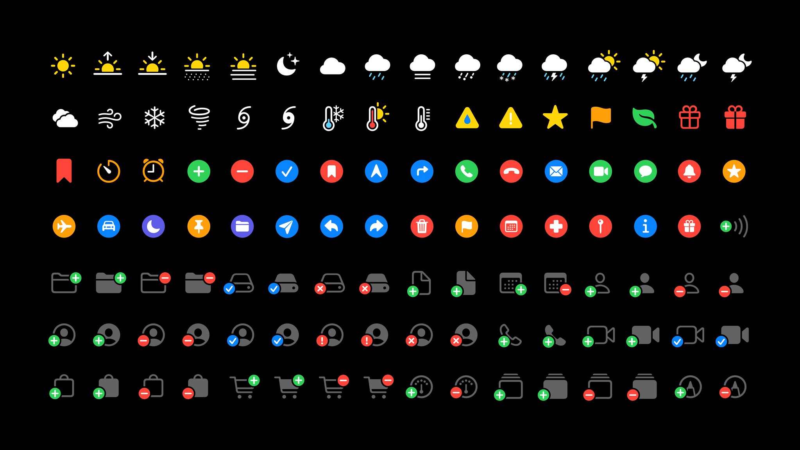

복잡한 개념이나 기능을 간단하고 직관적인 시각적 표현으로 전달하는 그래픽 요소.
사용자 인터페이스의 효율성과 사용성을 높이는 중요한 디자인 컴포넌트다.



# 특징

- 간결하고 명확한 시각적 표현
- 보편적으로 인식 가능한 상징 사용
- 일관된 스타일과 디자인 언어 (선 굵기, 모서리, 시각적 무게)
- 다양한 크기와 해상도에서의 가독성
- 브랜드 아이덴티티 반영 가능

# 주요 유형

### 픽토그램
실제 객체나 개념을 단순화한 그림 형태의 아이콘

### 추상적 아이콘
개념이나 기능을 상징적으로 표현한 아이콘

### 텍스트 기반 아이콘
문자나 약어를 활용한 아이콘

### 라인 아이콘
선으로 구성된 심플한 스타일의 아이콘

### 솔리드(채움) 아이콘
면으로 채운 아이콘. 선택 상태나 강조에 자주 쓰인다

### 앱 아이콘
홈 화면에서 앱을 대표하는 아이콘. UI 아이콘과 다른 규칙을 따른다

# 장점

### 빠른 인지
복잡한 정보를 신속하게 전달

### 공간 효율성
제한된 공간에서 효과적인 정보 전달

### 언어 장벽 극복
언어에 관계없이 의미 전달 가능

### 사용성 향상
직관적인 인터페이스로 사용자 경험 개선

### 심미적 가치
전체적인 디자인의 시각적 매력 증대

# 적용 사례

- 모바일 앱의 탭 바와 툴바
- 웹사이트의 기능 버튼
- 데스크톱 OS의 애플리케이션 아이콘
- 인포그래픽의 시각적 요소
- 사이니지 시스템의 안내 표지

# 디자인 시 고려사항

### 단순성
불필요한 세부사항을 제거하고 핵심 요소에 집중

### 일관성
아이콘 세트 전체에 걸친 일관된 스타일 유지

### 스케일링
다양한 크기에서도 명확히 인식될 수 있는 디자인

### 문화적 맥락
문화적 차이를 고려한 보편적 심볼 사용

### 색상 활용
의미 전달과 강조를 위한 전략적 색상 사용

### 접근성
색맹 등 다양한 사용자를 고려한 디자인. 아이콘에는 항상 텍스트 대안이 필요하다

### 그리드 시스템
정확하고 일관된 형태를 위한 그리드 기반 디자인

### 의미 명확성
아이콘의 의미가 즉각적으로 이해될 수 있도록 설계. 모호하면 레이블을 붙인다

# iOS에서는

## HIG가 말하는 것

iOS의 아이콘은 두 세계로 나뉜다. **UI 안의 심볼**과 **홈 화면의 앱 아이콘**.

**SF Symbols**
- Apple이 제공하는 6,000개 이상의 벡터 심볼. SF 서체와 같은 디자인 원리로 그려져 글자 옆에 두면 굵기와 기준선이 맞는다
- 9단계 굵기(서체와 동일)와 3단계 스케일(small / medium / large)
- 네 가지 렌더링 모드: Monochrome(단색), Hierarchical(한 색의 농도 차), Palette(색 지정), Multicolor(고유 색)
- 변형: `.fill`, `.circle`, `.square`, `.slash`, 숫자, 국가별 변형(예: 통화 기호)
- iOS 17부터 애니메이션(bounce, pulse, variable color, replace), iOS 18부터 wiggle, breathe, rotate
- HIG는 **가능하면 SF Symbols를 쓰고**, 커스텀 심볼이 필요하면 SF Symbols 앱에서 템플릿을 내보내 같은 규격으로 그리라고 한다

**앱 아이콘**
- 1024×1024 하나만 넣으면 모든 크기가 자동 생성된다
- 둥근 모서리는 시스템이 적용한다. 직접 깎지 않는다
- 텍스트, 사진, 투명 영역, 시스템 UI 요소 모방은 피한다
- iOS 18부터 다크 모드 변형과 틴트 변형을 따로 제공할 수 있다
- iOS 26의 Icon Composer로 레이어를 나눠 Liquid Glass 효과를 받는 아이콘을 만든다

**탭 바와 툴바**
- 탭 바 아이콘은 선택 시 채움(fill) 변형으로 바뀌는 것이 관례
- 아이콘만 있는 버튼도 VoiceOver를 위해 레이블이 있어야 한다

## SwiftUI로 구현하기

**기본 사용과 Label**

```swift
Label("즐겨찾기", systemImage: "star")          // 텍스트 + 심볼, 기준선 자동 정렬

Image(systemName: "star.fill")
    .imageScale(.large)
    .font(.title2.weight(.semibold))              // 심볼 굵기는 폰트 굵기를 따라감
```

**렌더링 모드**

```swift
Image(systemName: "cloud.sun.rain.fill")
    .symbolRenderingMode(.multicolor)             // 고유 색 (구름 회색, 해 노랑, 비 파랑)

Image(systemName: "speaker.wave.3.fill")
    .symbolRenderingMode(.hierarchical)           // 한 색의 농도로 깊이 표현
    .foregroundStyle(.blue)

Image(systemName: "person.crop.circle.badge.plus")
    .symbolRenderingMode(.palette)
    .foregroundStyle(.white, .green)              // 레이어별 색 지정
```

**탭 바: 선택 시 채움**

```swift
TabView {
    HomeView().tabItem { Label("홈", systemImage: "house") }        // 선택되면 house.fill로 자동 전환
    SearchView().tabItem { Label("검색", systemImage: "magnifyingglass") }
}
```

**애니메이션 (iOS 17+)**

```swift
Image(systemName: isPlaying ? "pause.fill" : "play.fill")
    .contentTransition(.symbolEffect(.replace))   // 교체 애니메이션

Image(systemName: "wifi")
    .symbolEffect(.variableColor.iterative, isActive: isConnecting)   // 연결 중 표시

Image(systemName: "bell")
    .symbolEffect(.bounce, value: notificationCount)
```

**커스텀 심볼**

SF Symbols 앱에서 기존 심볼을 템플릿으로 내보내고, 벡터 도구에서 수정한 뒤 에셋 카탈로그에 넣으면 `Image("custom.symbol")`로 쓸 수 있다. 굵기와 스케일 변형을 모두 채우면 시스템 심볼처럼 동작한다.

**아이콘만 있는 버튼**

```swift
Button("설정", systemImage: "gear") { }     // 레이블은 VoiceOver가 읽고, 화면에는 아이콘만
    .labelStyle(.iconOnly)
```

## 주의할 점

- **의미를 바꾸지 않는다**: SF Symbols 중 일부(`trash`, `heart`, `square.and.arrow.up`)는 시스템 전체에서 정해진 의미가 있다. 다른 의미로 쓰면 혼란을 준다
- **상표 심볼**: Apple 관련 심볼(`apple.logo`, `applewatch` 등)은 Apple 기능을 가리킬 때만 쓸 수 있다
- **크기 하드코딩 금지**: `.frame(width: 24, height: 24)` 대신 `.font`와 `.imageScale`로 조절한다. 그래야 Dynamic Type을 따른다
- **터치 영역**: 아이콘이 20pt여도 버튼은 44pt. `.padding`과 `.contentShape`로 확보한다
- **레이블 필수**: 아이콘만 있는 컨트롤은 `accessibilityLabel` 또는 `Label`의 제목이 있어야 한다. 심볼 이름("gear")이 그대로 읽히면 실패다
- **커스텀 아이콘의 선 굵기**: 라인 아이콘 세트를 가져올 때 SF Symbols Regular(약 1.5pt@17pt)와 맞춘다. 굵기가 다르면 한 화면에서 티가 난다
- **앱 아이콘 모서리**: 직접 깎으면 시스템 마스크와 이중으로 적용되어 테두리가 생긴다. 정사각형으로 제출한다

# 웹과 iOS 대응표

| 웹 | iOS / SwiftUI |
|---|---|
| 아이콘 폰트 (Font Awesome 등) | SF Symbols |
| SVG 스프라이트 | 커스텀 심볼 (에셋 카탈로그) |
| `currentColor` | `.foregroundStyle` (Monochrome 모드) |
| 다색 SVG | `.symbolRenderingMode(.multicolor)` / `.palette` |
| CSS 아이콘 애니메이션 | `symbolEffect`, `contentTransition(.symbolEffect)` |
| `aria-label` | `accessibilityLabel`, `Label` 제목 |
| 파비콘 + 매니페스트 아이콘 | 앱 아이콘 (1024pt 하나) |

# 함께 읽기

- [타이포그래피: 글자를 통한 효과적인 커뮤니케이션]() — SF Symbols는 서체의 연장
- [마이크로인터랙션: 작은 디테일의 큰 영향]() — 심볼 애니메이션
- [플랫 디자인: 단순함의 미학]() — 현대 아이콘의 시각 언어
