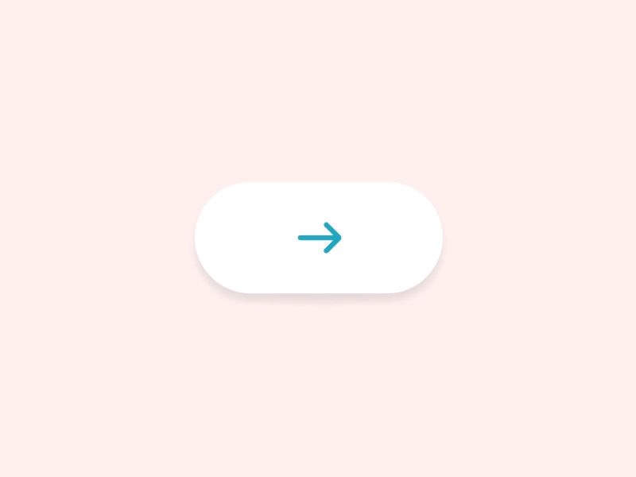

사용자 경험을 향상시키는 작고 세밀한 상호작용 요소.
토글이 넘어가는 순간, 좋아요 버튼이 튀는 순간, 당겨서 새로 고침할 때의 손맛 같은 것들이다.
제품의 사용성과 감성적 만족도를 높이는 데 중요한 역할을 한다.



# 특징

- 단일 작업 수행에 초점을 맞춘 간단한 상호작용
- 사용자 행동에 대한 즉각적인 피드백 제공
- 시각, 청각, 촉각 등 다양한 감각을 활용
- 제품의 전반적인 사용 경험을 부드럽게 만듦
- 브랜드의 개성을 표현하는 수단으로 활용

# 주요 구성 요소

Dan Saffer가 정리한 네 요소.

### 트리거
마이크로인터랙션을 시작하는 사용자 행동 또는 시스템 조건

### 규칙
트리거 발생 시 수행될 동작을 정의

### 피드백
사용자에게 제공되는 시각적, 청각적, 촉각적 반응

### 루프와 모드
반복되는 인터랙션과 상태 변화를 관리

# 장점

### 사용성 향상
직관적인 피드백으로 사용자 이해도 증진

### 사용자 만족도 증가
감성적 요소 추가로 제품 경험 개선

### 브랜드 차별화
독특한 인터랙션으로 브랜드 개성 표현

### 사용자 가이드
명시적 설명 없이 사용 방법 안내

### 오류 방지
실시간 피드백으로 사용자 실수 감소

# 적용 사례

- 버튼 클릭 시 미묘한 색상 변화나 애니메이션
- 폼 입력 필드의 실시간 유효성 검사 피드백
- 스크롤에 따른 헤더 디자인 변화
- 음소거 버튼의 아이콘 애니메이션
- 앱 로딩 시 표시되는 진행 상태 인디케이터

# 구현 시 고려사항

### 목적성
불필요한 장식이 아닌 기능적 목적 고려

### 일관성
전체 제품 디자인과의 조화 유지

### 성능 최적화
과도한 애니메이션으로 인한 성능 저하 방지

### 접근성
다양한 사용자를 위한 대체 수단 제공

### 문화적 맥락
글로벌 사용자를 고려한 보편적 인터랙션 설계

### 과도한 사용 주의
너무 많은 마이크로인터랙션은 오히려 산만할 수 있음

### 기기 특성 고려
다양한 기기와 플랫폼에서의 일관된 경험 제공

# iOS에서는

## HIG가 말하는 것

iOS가 다른 플랫폼과 가장 다른 지점이 여기다. iOS의 마이크로인터랙션에는 **촉각**이 있다.

- **햅틱(Haptics)**: Taptic Engine이 성공, 경고, 실패, 선택 변경, 충격 등을 서로 다른 진동 패턴으로 전달한다. HIG는 시스템이 정의한 패턴을 쓰고, 시각 피드백과 동기화하고, 남발하지 말라고 말한다
- **피드백은 즉각적으로**: 탭한 순간 하이라이트가 들어가야 한다. 0.1초만 늦어도 "안 눌린 것 같다"고 느낀다
- **시스템 컨트롤은 이미 갖고 있다**: `Toggle`, `Picker`, `Slider`, 당겨서 새로 고침, 스와이프 동작은 햅틱과 애니메이션이 내장되어 있다. 직접 만들면 이것들을 다시 구현해야 한다
- **SF Symbols 애니메이션**: iOS 17부터 심볼 자체가 바운스, 펄스, 교체 애니메이션을 지원해 아이콘 마이크로인터랙션이 표준화되었다

## SwiftUI로 구현하기

**좋아요 버튼: 시각 + 촉각**

```swift
struct LikeButton: View {
    @State private var isLiked = false

    var body: some View {
        Button {
            isLiked.toggle()
        } label: {
            Image(systemName: isLiked ? "heart.fill" : "heart")
                .foregroundStyle(isLiked ? .pink : .secondary)
                .contentTransition(.symbolEffect(.replace))     // 아이콘 교체 애니메이션
                .symbolEffect(.bounce, value: isLiked)          // 튀어오름
        }
        .sensoryFeedback(.impact(weight: .light), trigger: isLiked)  // 햅틱
        .accessibilityLabel(isLiked ? "좋아요 취소" : "좋아요")
    }
}
```

**숫자가 바뀔 때**

```swift
Text(count, format: .number)
    .contentTransition(.numericText(value: Double(count)))   // 자릿수만 굴러감
    .animation(.snappy, value: count)
```

**입력 검증 피드백**

```swift
TextField("이메일", text: $email)
    .textFieldStyle(.roundedBorder)
    .overlay(alignment: .trailing) {
        if isValid {
            Image(systemName: "checkmark.circle.fill")
                .foregroundStyle(.green)
                .transition(.scale.combined(with: .opacity))
                .padding(.trailing, 8)
        }
    }
    .animation(.spring(duration: 0.3), value: isValid)
    .sensoryFeedback(.success, trigger: isValid) { _, new in new }   // 유효해질 때만
```

**눌림 상태를 가진 커스텀 버튼**

```swift
struct SquishyButtonStyle: ButtonStyle {
    func makeBody(configuration: Configuration) -> some View {
        configuration.label
            .scaleEffect(configuration.isPressed ? 0.95 : 1)
            .opacity(configuration.isPressed ? 0.8 : 1)
            .animation(.easeOut(duration: 0.12), value: configuration.isPressed)
    }
}
```

## 주의할 점

- **햅틱 종류를 지킨다**: `.success`는 성공에, `.warning`은 주의에, `.selection`은 피커가 넘어갈 때. 의미를 섞으면 사용자의 학습이 깨진다
- **햅틱 남발 금지**: 스크롤마다, 탭마다 울리면 피로하다. 결과가 있는 순간(완료, 전환, 임계점 통과)에만 쓴다
- **시각 없이 촉각만 쓰지 않는다**: 햅틱이 꺼진 기기(iPad 대부분)와 무음 모드를 고려해 항상 시각 피드백을 동반한다
- **동작 줄이기**: 바운스 같은 과장된 효과는 `accessibilityReduceMotion`에서 생략하거나 페이드로 바꾼다
- **시스템 컨트롤 먼저**: `Toggle`을 직접 그리면 햅틱, 접근성, 눌림 영역을 전부 다시 만들어야 한다. 스타일만 바꾸고 싶다면 `ToggleStyle`을 쓴다

# 웹과 iOS 대응표

| 웹 | iOS / SwiftUI |
|---|---|
| `:hover` / `:active` 상태 | `ButtonStyle.Configuration.isPressed` (호버는 iPadOS 포인터에서만) |
| `navigator.vibrate()` (제한적) | `sensoryFeedback`, `UIImpactFeedbackGenerator` |
| 아이콘 교체 + CSS 애니메이션 | `symbolEffect`, `contentTransition(.symbolEffect(.replace))` |
| 숫자 롤링 라이브러리 | `contentTransition(.numericText())` |
| 폼 유효성 아이콘 토글 | `overlay` + `transition` + `sensoryFeedback(.success)` |
| 커스텀 토글 컴포넌트 | `ToggleStyle` |

# 함께 읽기

- [애니메이션과 모션: 동적 사용자 경험의 핵심]() — 마이크로인터랙션이 속한 더 큰 범주
- [제스처 기반 인터페이스: 직관적 조작의 혁신]()
- [아이콘 디자인: 시각적 언어의 핵심 요소]() — SF Symbols 애니메이션
