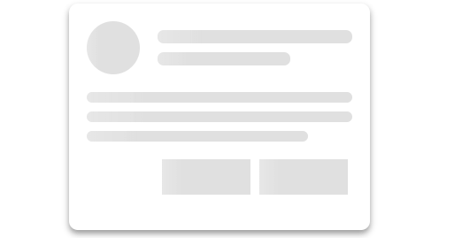

콘텐츠가 로딩되는 동안 사용자에게 표시되는 시각적 플레이스홀더 기법.
실제 콘텐츠의 윤곽을 회색 블록으로 먼저 보여 줘서, 체감 대기 시간을 줄이고 "곧 무엇이 나올지"를 예고한다.



# 특징

- 콘텐츠의 기본 레이아웃을 미리 보여 줌
- 애니메이션 효과(펄스, 쉬머)를 통한 로딩 상태 표현
- 실제 콘텐츠와 유사한 구조 제공
- 중립적인 색상(주로 회색 계열) 사용
- 스피너와 달리 "어디에 무엇이" 올지 알려 준다

# 장점

### 사용자의 기대 관리
로딩될 콘텐츠의 구조를 미리 제시

### 인터페이스의 반응성 향상
즉각적인 피드백 제공. 빈 화면이나 스피너보다 체감 속도가 빠르다

### 사용자 참여도 증가
빈 화면보다 더 나은 사용자 경험 제공

### 점진적 로딩 지원
부분적으로 로드된 콘텐츠 표현 가능. 텍스트가 먼저 오고 이미지가 뒤에 와도 자연스럽다

# 적용 사례

- 소셜 미디어 피드 (Facebook, LinkedIn)
- 콘텐츠 스트리밍 서비스 (YouTube, Netflix)
- 이커머스 제품 목록 페이지
- 뉴스 기사나 블로그 포스트 로딩 화면
- App Store, Apple Music의 목록 로딩

# 주의사항

### 레이아웃 일치
스켈레톤과 실제 콘텐츠의 모양이 다르면 화면이 "덜컹"한다. 같은 뷰에서 만든다

### 애니메이션 절제
쉬머가 너무 빠르거나 밝으면 산만하다. 느리고 은은하게

### 표시 시간
0.3초 안에 끝나는 로딩에는 스켈레톤이 오히려 깜빡임이 된다. 짧은 지연 뒤에 표시한다

### 실패 상태
로딩이 실패하면 스켈레톤이 영원히 남는다. 오류 상태로 반드시 전환한다

### 접근성
스크린 리더가 빈 블록을 읽지 않게 하고, "로딩 중"이라고 알려 준다

### 다크 모드
회색 블록은 다크 모드에서 배경과 구분되어야 한다

# iOS에서는

## HIG가 말하는 것

HIG의 Loading 패턴은 세 가지를 요구한다.

- **가능하면 로딩을 보이지 않게**: 캐시된 데이터를 먼저 보여 주고 뒤에서 갱신한다. 로딩 화면을 잘 만드는 것보다 안 보이게 하는 게 낫다
- **콘텐츠를 즉시 보여 줄 수 없다면 플레이스홀더를**: HIG는 "콘텐츠의 모양을 암시하는 플레이스홀더"를 권한다. 이것이 스켈레톤 UI다
- **진행률을 알 수 있으면 보여 준다**: 끝을 아는 작업은 `ProgressView(value:)`, 모르는 작업은 스피너 또는 스켈레톤

Apple의 기본 앱은 스켈레톤을 조용히 쓴다. App Store 검색 결과나 Apple Music 앨범 목록이 로딩될 때 회색 블록이 짧게 보인다. 쉬머 애니메이션은 거의 쓰지 않고 정적인 블록이 대부분이다.

## SwiftUI로 구현하기

SwiftUI에는 스켈레톤 UI를 위한 전용 수정자가 있다. 실제 뷰를 그대로 두고 **가린다**.

**`.redacted(reason: .placeholder)`**

```swift
struct FeedView: View {
    @State private var articles: [Article] = Article.placeholders   // 가짜 데이터
    @State private var isLoading = true

    var body: some View {
        List(articles) { article in
            ArticleRow(article: article)
        }
        .redacted(reason: isLoading ? .placeholder : [])   // 텍스트와 이미지를 회색 블록으로
        .disabled(isLoading)
        .task {
            articles = try? await api.fetch() ?? []
            withAnimation(.easeOut(duration: 0.25)) { isLoading = false }
        }
    }
}
```

실제 `ArticleRow`를 그대로 쓰기 때문에 스켈레톤과 실제 콘텐츠의 레이아웃이 **반드시** 일치한다. 별도의 스켈레톤 뷰를 만들 필요가 없다.

**쉬머 효과를 더하고 싶다면**

```swift
struct Shimmer: ViewModifier {
    @State private var phase: CGFloat = -1
    @Environment(\.accessibilityReduceMotion) private var reduceMotion

    func body(content: Content) -> some View {
        content.overlay {
            if !reduceMotion {
                LinearGradient(colors: [.clear, .white.opacity(0.4), .clear],
                               startPoint: .leading, endPoint: .trailing)
                    .offset(x: phase * 300)
                    .onAppear {
                        withAnimation(.linear(duration: 1.4).repeatForever(autoreverses: false)) {
                            phase = 1
                        }
                    }
            }
        }
        .mask(content)
    }
}
```

**짧은 로딩에서는 숨기기**

```swift
.task {
    try? await Task.sleep(for: .milliseconds(300))   // 300ms 안에 끝나면 스켈레톤을 안 보여 줌
    if stillLoading { showSkeleton = true }
}
```

**실패 상태**

```swift
if let error {
    ContentUnavailableView("불러올 수 없습니다",
                           systemImage: "wifi.exclamationmark",
                           description: Text(error.localizedDescription))
}
```

## 주의할 점

- **`redacted`는 레이아웃을 바꾸지 않는다**: 플레이스홀더 데이터의 텍스트 길이가 실제와 비슷해야 블록 크기가 자연스럽다. "Lorem ipsum" 두 줄 정도로
- **`.unredacted()`**: 로딩 중에도 보여야 할 것(섹션 제목, 고정 버튼)에는 이 수정자로 가림을 해제한다
- **VoiceOver**: `.redacted` 영역은 그대로 읽힌다. `.accessibilityHidden(isLoading)`과 함께 "로딩 중" 레이블을 가진 요소를 하나 둔다
- **다크 모드**: `redacted`는 시스템 색을 쓰므로 자동 대응된다. 직접 만든 회색 블록은 `Color(.systemFill)`을 쓴다
- **애니메이션 전환**: 스켈레톤에서 실제 콘텐츠로 바뀔 때 짧은 페이드를 넣으면 덜컹거림이 줄어든다
- **캐시 우선**: 스켈레톤보다 나은 것은 이전 데이터다. 두 번째 방문부터는 저장된 데이터를 먼저 보여 주고 갱신한다

# 웹과 iOS 대응표

| 웹 | iOS / SwiftUI |
|---|---|
| 별도 스켈레톤 컴포넌트 (react-loading-skeleton 등) | 실제 뷰 + `.redacted(reason: .placeholder)` |
| CSS 쉬머 `@keyframes` | `LinearGradient` + `repeatForever` 애니메이션 |
| `aria-busy="true"` | `.accessibilityHidden` + 로딩 레이블 |
| 스피너 `<div class="spinner">` | `ProgressView()` |
| 진행 바 `<progress>` | `ProgressView(value:total:)` |
| 오류 상태 컴포넌트 | `ContentUnavailableView` |
| SWR / stale-while-revalidate | 캐시 먼저 표시 후 `.task`로 갱신 |

# 함께 읽기

- [카드 기반 디자인: 정보의 모듈화]() — 스켈레톤이 가장 자주 쓰이는 대상
- [애니메이션과 모션: 동적 사용자 경험의 핵심]() — 쉬머와 전환 애니메이션
- [비주얼 리치 디자인: 시각적 풍부함의 세계]() — 무거운 콘텐츠의 로딩
