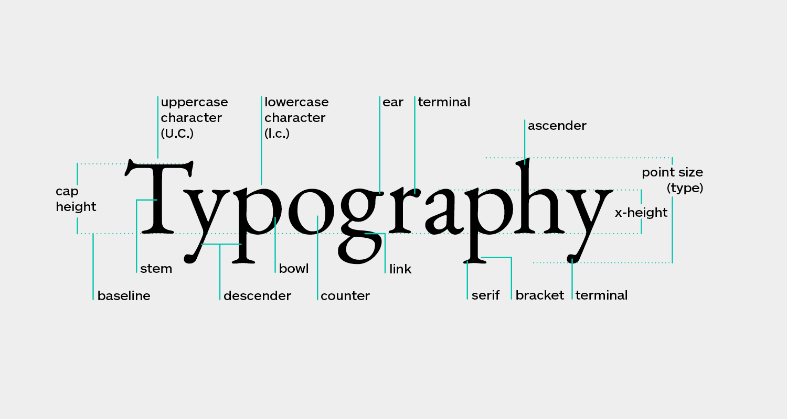

텍스트의 시각적 구성과 배열을 통해 정보를 효과적으로 전달하고 디자인의 미적 가치를 높이는 기법.
가독성, 정보의 계층화, 브랜드 아이덴티티를 고려한 전략적 글자 디자인이다.



이 글은 글자를 다루는 **기법**을 다룬다. 글자를 화면의 주인공으로 세우는 **스타일**은 [타이포그래피 중심 디자인]()에서 다룬다.

## 특징

- 폰트 선택과 조합을 통한 브랜드 개성 표현
- 텍스트 크기, 굵기, 간격 조절로 정보 계층화
- 색상과 대비를 활용한 가독성 및 강조 효과
- 레이아웃과 정렬을 통한 시각적 흐름 유도
- 글자와 여백의 조화로운 배치

## 주요 요소

#### 폰트 패밀리
서체의 종류와 스타일 (serif, sans-serif, monospace, script 등)

#### 글자 크기
텍스트의 크기와 비율 (제목, 본문, 캡션 등). 타입 스케일

#### 행간 (Line Height)
텍스트 줄 사이의 수직 간격. 본문은 글자 크기의 1.3~1.6배

#### 자간 (Letter Spacing)
글자 사이의 간격. 큰 제목은 좁히고, 작은 대문자는 넓힌다

#### 줄 길이 (Measure)
한 줄의 글자 수. 45~75자가 읽기 편하다

#### 단락 스타일
들여쓰기, 정렬 방식, 단락 간격 등

#### 컬러와 대비
텍스트와 배경 간의 색상 관계

## 장점

#### 정보 전달력 향상
효과적인 계층 구조로 내용의 중요도 표현

#### 브랜드 아이덴티티 강화
일관된 타이포그래피로 브랜드 이미지 구축

#### 사용자 경험 개선
가독성 향상으로 콘텐츠 소비 편의성 증대

#### 감성적 커뮤니케이션
글꼴을 통한 분위기와 톤 전달

#### 시각적 흥미 유발
다양한 타이포그래피 요소로 디자인 풍성화

## 적용 사례

- 웹사이트 헤더와 본문 디자인
- 모바일 앱 인터페이스의 텍스트 레이아웃
- 브랜드 로고 및 광고 카피
- 출판물 (책, 잡지) 레이아웃
- 인포그래픽과 데이터 시각화

## 구현 시 고려사항

#### 가독성 우선
글자 크기, 행간, 대비 등을 고려한 읽기 쉬운 텍스트 구성

#### 반응형 대응
다양한 화면 크기와 사용자 설정에서의 일관된 타이포그래피 유지

#### 브랜드 일관성
전체 디자인 시스템과 조화로운 타이포그래피 선택

#### 문화적 맥락
타겟 사용자의 언어와 문화에 적합한 폰트 선택. 한글은 라틴 문자보다 글자당 정보량이 많아 같은 크기에서 더 빽빽해 보인다

#### 접근성
저시력 사용자를 위한 적절한 크기와 대비, 사용자 글자 크기 설정 존중

#### 성능 최적화
웹 폰트 사용 시 로딩 시간 고려

#### 계층 구조
정보의 중요도에 따른 명확한 타이포그래피 계층 설정

#### 숫자 처리
표나 타이머에서는 폭이 고정된 숫자(tabular figures)를 쓴다

## iOS에서는

### HIG가 말하는 것

iOS 타이포그래피의 두 기둥은 **San Francisco**와 **Dynamic Type**이다.

**San Francisco (SF)**
- 화면용으로 설계된 Apple의 시스템 서체. iOS, macOS, tvOS에서는 SF Pro, watchOS에서는 SF Compact
- 크기에 따라 자동으로 글자 모양이 바뀐다. 20pt 이상은 Display, 미만은 Text 변형으로 작은 글자의 자간이 자동으로 넓어진다
- 변형: SF Pro Rounded(둥근), SF Mono(고정폭), New York(세리프)
- 한국어 시스템 서체는 Apple SD Gothic Neo. SF와 자동으로 섞여 쓰인다
- 9단계 굵기(Ultralight ~ Black)와 폭 변형(Compressed ~ Expanded)

**Dynamic Type**
- 설정 > 디스플레이 및 밝기 > 텍스트 크기에서 사용자가 7단계 + 접근성 5단계로 조절
- 11개 텍스트 스타일(Large Title ~ Caption 2)이 각 단계에 맞는 크기와 행간을 가진다
- HIG는 **모든 텍스트가 Dynamic Type을 따르기를** 요구한다. 고정 크기 텍스트는 사용자의 선택을 무시하는 것이다

**기준**
- 본문 기본 17pt, 최소 11pt
- 텍스트와 배경 대비 4.5:1 이상 (작은 텍스트), 3:1 이상 (큰 텍스트)
- 줄 길이는 iPad에서 특히 주의. 가로 모드 전체 폭은 너무 길다

### SwiftUI로 구현하기

**텍스트 스타일을 쓴다 (크기를 쓰지 않는다)**

```swift
VStack(alignment: .leading, spacing: 8) {
    Text("회의록").font(.largeTitle.bold())
    Text("2026년 11월 15일").font(.subheadline).foregroundStyle(.secondary)
    Text("오늘 회의에서는 다음 분기 로드맵을 논의했습니다.")
        .font(.body)
        .lineSpacing(4)
}
```

`.font(.system(size: 17))`이 아니라 `.font(.body)`. 전자는 사용자가 글자를 키워도 17pt에 머문다.

**서체 변형**

```swift
Text("3:24").font(.system(.title, design: .rounded, weight: .semibold))   // SF Pro Rounded
Text("let x = 1").font(.system(.body, design: .monospaced))                // SF Mono
Text("서문").font(.system(.title2, design: .serif))                          // New York
```

**숫자 폭 고정과 자간**

```swift
Text(timeRemaining, format: .time(pattern: .minuteSecond))
    .font(.system(size: 64, weight: .light, design: .rounded))
    .monospacedDigit()            // 숫자가 바뀌어도 흔들리지 않음

Text("SECTION").font(.caption2.weight(.semibold)).tracking(1.2)   // 작은 대문자는 자간 넓게
```

**커스텀 폰트도 Dynamic Type에 연결**

```swift
extension Font {
    static func pretendard(_ weight: String, _ style: Font.TextStyle) -> Font {
        let base: CGFloat = switch style {
            case .largeTitle: 34; case .title: 28; case .headline: 17
            case .body: 17; case .caption: 12; default: 15
        }
        return .custom("Pretendard-\(weight)", size: base, relativeTo: style)
    }
}

Text("안녕하세요").font(.pretendard("Medium", .body))
```

`relativeTo:`가 핵심이다. 이것이 없으면 커스텀 폰트는 사용자 설정을 무시한다.

**비텍스트 크기도 비례시키기**

```swift
@ScaledMetric(relativeTo: .body) private var iconSize: CGFloat = 20

Image(systemName: "bell").font(.system(size: iconSize))
```

### 주의할 점

- **접근성 크기 테스트**: Xcode Previews에서 `.environment(\.dynamicTypeSize, .accessibility5)`로 최대 크기를 본다. 잘림, 겹침, 가로 레이아웃 붕괴가 거기서 드러난다
- **`lineLimit`과 `minimumScaleFactor`**: 글자를 줄여서 맞추는 것은 최후의 수단이다. 먼저 레이아웃을 세로로 바꾸는 쪽(`ViewThatFits`)을 고려한다
- **한글 행간**: SF 기준 행간은 한글에 조금 좁다. 한글 본문은 `.lineSpacing(2~4)`를 더하면 읽기 편하다
- **텍스트를 이미지로 만들지 않는다**: Dynamic Type, VoiceOver, 번역, 다크 모드가 모두 깨진다
- **폰트 번들 크기**: 커스텀 폰트 패밀리 전체를 넣으면 수 MB다. 필요한 굵기만 넣고, 가능하면 가변 폰트 하나로
- **Localizable**: 글자 길이는 언어마다 다르다. 독일어는 영어의 1.3배, 한국어는 0.8배 정도. 고정 폭 레이블은 어딘가에서 잘린다

## 웹과 iOS 대응표

| 웹 | iOS / SwiftUI |
|---|---|
| `font-family: -apple-system, system-ui` | SF Pro (기본) |
| `font-size: 1rem` + 사용자 브라우저 설정 | `.font(.body)` + Dynamic Type |
| `clamp()` 유동 크기 | `@ScaledMetric` |
| `@font-face` + `font-display` | 번들 폰트 + `Font.custom(_:size:relativeTo:)` |
| `line-height` | `.lineSpacing` (추가 간격) |
| `letter-spacing` | `.tracking` / `.kerning` |
| `font-variant-numeric: tabular-nums` | `.monospacedDigit()` |
| `font-family: monospace` / `serif` | `design: .monospaced` / `.serif` |
| `max-width: 65ch` | `.frame(maxWidth: 680)` |
| `text-overflow: ellipsis` | `.lineLimit` + `.truncationMode` |

## 함께 읽기

- [타이포그래피 중심 디자인: 글자의 힘]() — 스타일로서의 타이포그래피
- [비주얼 계층구조: 시각적 중요도의 체계화]() — 텍스트 스타일로 만드는 위계
- [반응형 디자인: 모든 화면에 최적화된 경험]() — Dynamic Type과 레이아웃
