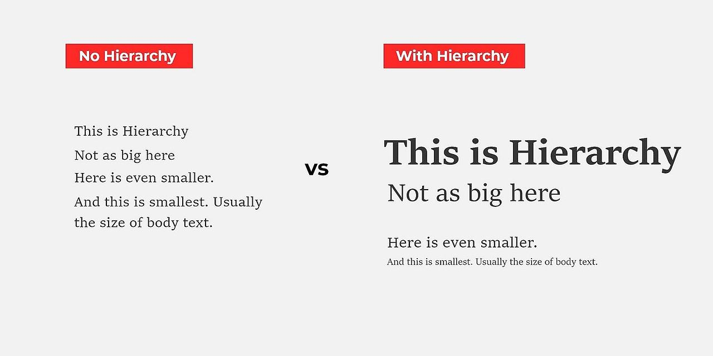

디자인 요소들의 시각적 중요도를 체계화하여 사용자의 주의를 효과적으로 유도하는 기법.
정보의 우선순위를 시각적으로 표현해 사용자가 "무엇을 먼저 봐야 하는지" 생각하지 않게 한다.



# 특징

- 디자인 요소들 간의 시각적 우선순위 설정
- 색상, 크기, 대비, 위치 등을 활용한 강조
- 사용자의 시선 흐름을 고려한 레이아웃 구성 (F 패턴, Z 패턴)
- 정보의 논리적 구조를 시각적으로 표현
- 직관적인 정보 탐색 경로 제공

# 주요 요소

### 크기와 스케일
중요한 요소를 더 크게 표현

### 색상과 대비
강조하고자 하는 요소에 눈에 띄는 색상 사용

### 타이포그래피
폰트 크기, 굵기, 스타일을 통한 텍스트 계층화

### 여백과 간격
요소 간 간격을 통한 관계성 표현

### 위치와 정렬
중요 요소를 상단이나 중앙에 배치

### 형태와 그룹핑
유사한 요소들을 시각적으로 그룹화

### 깊이
그림자, 재질, 레이어로 "위에 있는 것"을 표현

# 장점

### 정보 전달 효율성
중요 정보를 빠르게 인지할 수 있게 함

### 사용자 경험 개선
직관적인 정보 구조로 사용성 향상

### 브랜드 일관성
시각적 우선순위를 통한 브랜드 메시지 강화

### 의사결정 지원
사용자의 행동을 유도하는 명확한 시각적 단서 제공

### 인지 부하 감소
복잡한 정보를 체계적으로 정리하여 이해도 증진

# 적용 사례

- 웹사이트 홈페이지의 주요 섹션 구성
- 모바일 앱의 네비게이션 메뉴 디자인
- 인포그래픽에서의 데이터 시각화
- 광고 디자인에서의 주요 메시지 강조
- 대시보드 UI에서의 중요 지표 표시

# 구현 시 고려사항

### 사용자 목표 이해
타겟 사용자의 니즈와 행동 패턴 분석

### 콘텐츠 분석
정보의 중요도와 관계성 파악

### 일관성 유지
전체 디자인에 걸쳐 일관된 시각적 계층 적용

### 접근성 고려
색맹 등 다양한 사용자를 위한 대체 강조 방법 제공

### 반응형 디자인
다양한 화면 크기에서의 계층구조 유지 방안 고려

### 사용자 테스트
실제 사용자를 통한 시각적 계층구조의 효과성 검증

### 과도한 복잡성 지양
너무 많은 계층은 오히려 혼란을 야기할 수 있음. 모든 것을 강조하면 아무것도 강조되지 않는다

### 문화적 차이 고려
색상이나 상징의 문화적 의미 차이 인지

# iOS에서는

## HIG가 말하는 것

iOS는 계층을 표현하는 **이름 붙은 단계**를 제공한다. 디자이너가 매번 "이건 15pt 회색"이라고 정하는 대신 "이건 secondary"라고 말한다.

**텍스트 계층: Dynamic Type 텍스트 스타일**

| 스타일 | 기본 크기 | 용도 |
|---|---|---|
| Large Title | 34pt | 화면 제목 |
| Title 1 / 2 / 3 | 28 / 22 / 20pt | 섹션 제목 |
| Headline | 17pt semibold | 항목 제목 |
| Body | 17pt | 본문 |
| Callout / Subheadline | 16 / 15pt | 보조 설명 |
| Footnote | 13pt | 각주 |
| Caption 1 / 2 | 12 / 11pt | 레이블, 타임스탬프 |

**색상 계층: 의미론적 전경색**

- `primary`(label): 핵심 텍스트
- `secondary`: 보조 텍스트
- `tertiary`: 플레이스홀더, 비활성
- `quaternary`: 구분선, 배경 장식

**배경 계층**

- `systemBackground` → `secondarySystemBackground` → `tertiarySystemBackground`: 겹쳐 올라갈수록 한 단계씩 밝아진다(다크 모드) 또는 어두워진다(라이트 모드)

**강조 계층: 버튼 스타일**

- `.borderedProminent`(채움) > `.bordered`(연한 배경) > `.borderless`(텍스트만)

이 단계들은 라이트/다크 모드, 고대비 설정, Dynamic Type에 모두 자동 대응한다. 직접 색과 크기를 정하면 그 대응을 전부 잃는다.

## SwiftUI로 구현하기

**한 셀 안의 계층**

```swift
struct ArticleRow: View {
    let article: Article

    var body: some View {
        HStack(alignment: .top, spacing: 12) {
            AsyncImage(url: article.thumbnail) { $0.resizable().scaledToFill() }
                placeholder: { Color(.tertiarySystemFill) }
                .frame(width: 72, height: 72)
                .clipShape(RoundedRectangle(cornerRadius: 10))

            VStack(alignment: .leading, spacing: 4) {
                Text(article.category.uppercased())
                    .font(.caption2.weight(.semibold))
                    .foregroundStyle(.tint)                 // 3순위: 작지만 색으로 분류 표시
                Text(article.title)
                    .font(.headline)
                    .foregroundStyle(.primary)              // 1순위
                    .lineLimit(2)
                Text(article.summary)
                    .font(.subheadline)
                    .foregroundStyle(.secondary)            // 2순위
                    .lineLimit(2)
                Text(article.date, style: .relative)
                    .font(.caption)
                    .foregroundStyle(.tertiary)             // 4순위
            }
        }
        .padding(.vertical, 8)
    }
}
```

크기(headline > subheadline > caption), 색(primary > secondary > tertiary), 위치(위에서 아래)가 같은 방향을 가리킨다. 세 축이 일치할 때 계층이 명확하다.

**버튼 쌍의 계층**

```swift
VStack(spacing: 12) {
    Button("구독하기") { }
        .buttonStyle(.borderedProminent)     // 주 동작
        .controlSize(.large)
    Button("나중에") { }
        .buttonStyle(.borderless)            // 보조 동작
        .foregroundStyle(.secondary)
}
```

**배경으로 레이어 표현**

```swift
ZStack {
    Color(.systemGroupedBackground)                 // 바닥
    VStack {
        Card().background(Color(.secondarySystemGroupedBackground))   // 한 단계 위
    }
}
```

## 주의할 점

- **색만으로 계층을 만들지 않는다**: 색각 이상이나 고대비 설정에서 사라진다. 크기나 굵기 중 하나는 함께 바꾼다
- **굵기 남용**: 한 화면에 `bold`가 셋 이상이면 계층이 무너진다. 제목 하나만 굵게
- **`.tertiary` 텍스트의 대비**: 작고 흐린 텍스트는 대비 기준(4.5:1)에 걸리기 쉽다. 정보성 텍스트는 `.secondary`까지만, `.tertiary`는 장식에
- **큰 글자 설정에서의 역전**: Dynamic Type을 최대로 올리면 `caption`도 커진다. 상대 비율은 유지되므로 괜찮지만, 고정 크기를 섞어 쓰면 보조 텍스트가 제목보다 커지는 역전이 일어난다
- **VoiceOver 순서**: 시각적 계층과 읽기 순서가 다르면 `accessibilitySortPriority`로 맞춘다. 제목이 먼저 읽혀야 한다

# 웹과 iOS 대응표

| 웹 | iOS / SwiftUI |
|---|---|
| `h1`~`h6`, `p`, `small` | `.largeTitle` ~ `.caption2` 텍스트 스타일 |
| `color: var(--text-secondary)` | `.foregroundStyle(.secondary)` |
| `opacity: 0.6`로 흐리게 | `.secondary` / `.tertiary` (불투명도 아님, 색상 계층) |
| Primary / Secondary / Ghost 버튼 | `.borderedProminent` / `.bordered` / `.borderless` |
| 배경 `--surface-1`, `--surface-2` | `systemBackground` / `secondarySystemBackground` |
| `z-index` + `box-shadow` | `ZStack` + Material / `.shadow` |
| `aria-level`, 헤딩 순서 | `accessibilityAddTraits(.isHeader)`, `accessibilitySortPriority` |

# 함께 읽기

- [타이포그래피: 글자를 통한 효과적인 커뮤니케이션]() — 텍스트 계층의 도구
- [화이트 스페이스 활용: 여백의 미학]() — 여백이 만드는 그룹
- [글라스모피즘: 투명함의 미학]() — 재질로 표현하는 깊이 계층
