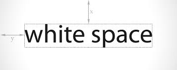

디자인에서 의도적으로 비워 둔 공간을 활용하여 가독성, 사용성, 심미성을 향상시키는 기법.
콘텐츠 간의 관계를 명확히 하고 사용자의 시선을 효과적으로 유도한다. 색이 흰색일 필요는 없다. "네거티브 스페이스"라고도 부른다.



## 특징

- 요소 간 여백을 통한 시각적 휴식 제공
- 콘텐츠의 구조와 계층을 명확히 표현
- 주요 요소에 대한 집중도 향상
- 전체적인 디자인의 균형과 조화 창출
- 미니멀리즘과 세련된 느낌 연출
- 가까운 것은 관련 있고, 먼 것은 관련 없다는 신호 (게슈탈트의 근접성 원리)

## 주요 활용 방식

#### 매크로 화이트스페이스
큰 규모의 여백으로 주요 섹션 구분

#### 마이크로 화이트스페이스
작은 요소들 사이의 미세한 여백 조정 (행간, 자간, 아이콘과 텍스트 사이)

#### 액티브 화이트스페이스
의도적으로 형태를 만들어 내는 여백

#### 패시브 화이트스페이스
자연스럽게 발생하는 배경의 여백

## 장점

#### 가독성 향상
텍스트와 요소 간 적절한 간격으로 읽기 쉬움

#### 사용자 경험 개선
복잡성 감소로 인한 직관적 인터페이스 제공

#### 콘텐츠 강조
중요 요소를 둘러싼 여백으로 주목도 증가

#### 브랜드 이미지 향상
세련되고 전문적인 디자인 인상 제공

#### 사용자 피로도 감소
시각적 여유 공간으로 인한 편안한 사용 경험

## 적용 사례

- 웹사이트의 헤더와 섹션 간 여백
- 모바일 앱의 UI 요소 간 간격
- 인쇄 매체의 레이아웃 디자인
- 제품 패키지 디자인의 여백 활용
- 로고 디자인에서의 여백 활용

## 구현 시 고려사항

#### 콘텐츠 우선순위
중요 정보가 충분한 여백으로 강조되도록 설계

#### 일관성 유지
전체 디자인에 걸쳐 일관된 여백 체계 적용

#### 반응형 디자인
다양한 화면 크기에서의 여백 조정 방안 고려

#### 과도한 사용 주의
필요 이상의 여백은 스크롤을 늘리고 정보 밀도를 떨어뜨린다

#### 사용자 테스트
실제 사용자를 통한 여백 사용의 효과성 검증

#### 문화적 차이
여백에 대한 문화적 인식 차이 고려 (정보 밀도가 높은 UI를 선호하는 시장도 있다)

#### 정보 밀도 균형
필요한 정보량과 여백의 적절한 균형 유지

#### 그리드 시스템 활용
일관된 여백 적용을 위한 그리드 시스템 사용

## iOS에서는

### HIG가 말하는 것

iOS의 여백은 디자이너가 매번 정하는 값이 아니라 **시스템이 정해 둔 값**이 많다.

- **레이아웃 마진**: 화면 가장자리 여백. 시스템 컨트롤이 모두 이 선에 맞춰 있어서, 커스텀 뷰도 이 선에 맞추면 저절로 정돈된다
- **세이프 에어리어**: 가장 바깥의 여백. 콘텐츠가 노치나 홈 인디케이터와 겹치지 않게 한다
- **리스트의 인셋 그룹(Inset Grouped)**: iOS 13부터 설정 앱이 쓰는 스타일. 섹션 사이의 큼직한 여백이 그룹을 나누고, 섹션 안의 좁은 간격이 항목을 묶는다. 매크로/마이크로 여백의 교과서다
- **44pt 터치 영역**: 버튼이 작아도 주변 여백을 터치 영역에 포함시켜 44pt를 확보한다
- **콘텐츠가 바 아래로 흐른다**: 스크롤 콘텐츠는 반투명 바 아래로 지나가지만, 멈췄을 때는 바에 가리지 않는 여백이 자동으로 들어간다

HIG는 여백을 "비움"이 아니라 **그룹을 만드는 도구**로 본다. 여백이 다르면 다른 그룹이다.

### SwiftUI로 구현하기

SwiftUI의 기본 간격은 이미 HIG를 따른다. `.padding()`의 기본값과 `VStack`의 기본 `spacing`은 플랫폼에 맞게 정해져 있다.

**시스템 여백에 맞추기**

```swift
ScrollView {
    VStack(alignment: .leading, spacing: 24) {       // 매크로: 섹션 간격
        SectionHeader("오늘")
        VStack(alignment: .leading, spacing: 8) {     // 마이크로: 항목 간격
            TaskRow(); TaskRow(); TaskRow()
        }
        SectionHeader("내일")
        VStack(alignment: .leading, spacing: 8) {
            TaskRow(); TaskRow()
        }
    }
    .scenePadding()                                   // 시스템 레이아웃 마진 (16/20pt 자동)
}
```

`.scenePadding()`은 기기에 따라 적절한 가장자리 여백을 넣는다. `.padding(16)`처럼 숫자를 박는 것보다 낫다.

**인셋 그룹 리스트**

```swift
List {
    Section("계정") {
        NavigationLink("프로필") { }
        NavigationLink("알림") { }
    }
    Section("정보") {
        LabeledContent("버전", value: "3.0")
    }
}
.listStyle(.insetGrouped)   // 섹션 간 여백과 둥근 그룹을 시스템이 처리
```

**스크롤 콘텐츠 가장자리 여백 (iOS 17+)**

```swift
ScrollView(.horizontal) {
    HStack(spacing: 12) { ForEach(cards) { Card($0) } }
}
.contentMargins(.horizontal, 20, for: .scrollContent)   // 스크롤 영역은 끝까지, 콘텐츠만 들여쓰기
```

**터치 영역 확보**

```swift
Button { } label: {
    Image(systemName: "xmark")
        .font(.footnote)
        .padding(12)                 // 작은 아이콘이지만 여백으로 44pt 확보
}
.contentShape(Rectangle())           // 여백까지 터치 인식
```

### 주의할 점

- **Dynamic Type과 함께 늘어나야 한다**: 고정 여백은 글자가 커지면 상대적으로 좁아 보인다. 중요한 간격은 `@ScaledMetric`으로 글자 크기에 비례시킨다
- **`Spacer()` 남용**: `Spacer`는 남는 공간을 전부 차지한다. 작은 화면에서 0이 되어 요소가 붙을 수 있으니 `Spacer(minLength:)`를 쓴다
- **리스트 셀 여백을 직접 건드리지 않는다**: `listRowInsets`를 바꾸면 시스템 정렬선에서 벗어난다. 꼭 필요할 때만, 섹션 전체에 일관되게
- **빈 화면의 여백**: 내용이 없을 때 빈 공간은 여백이 아니라 공백이다. `ContentUnavailableView`로 안내를 넣는다
- **여백을 색으로 구분하지 않는다**: 그룹을 나누려고 배경색을 넣기 전에 여백만으로 되는지 먼저 본다. iOS는 선과 색보다 여백으로 나누는 쪽을 선호한다

## 웹과 iOS 대응표

| 웹 | iOS / SwiftUI |
|---|---|
| `padding: 0 16px` 컨테이너 | `.scenePadding()` |
| `margin-bottom` 섹션 간격 | `VStack(spacing:)` |
| `gap` (Flexbox / Grid) | `HStack` / `VStack` / `LazyVGrid`의 `spacing` |
| `scroll-padding` | `.contentMargins` |
| `line-height`, `letter-spacing` | `.lineSpacing`, `.tracking` |
| 터치 영역 확장 (`::before` 패딩) | `.padding` + `.contentShape` |
| 카드 그룹 사이 큰 여백 | `.listStyle(.insetGrouped)` |

## 함께 읽기

- [그리드 시스템: 디자인의 골격]() — 여백에 체계를 주는 틀
- [미니멀리즘 디자인: 적은 것이 더 많은 것이다]() — 여백을 가장 적극적으로 쓰는 스타일
- [비주얼 계층구조: 시각적 중요도의 체계화]() — 여백이 만드는 위계
